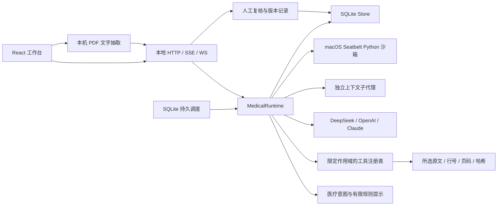

> 0.6 当前通用平台实现、Git/终端新能力与验收边界见 [GENERIC_PLATFORM_06.md](GENERIC_PLATFORM_06.md)。以下保留先前版本设计说明；与 0.6 冲突时以新文档为准。

# 医疗适配器与共享运行内核

0.4 的通用架构与接口见 [GENERIC_RUNTIME.md](GENERIC_RUNTIME.md)。以下描述医疗领域流程；模型工具循环现由共享 AgentRuntime 实际执行，Provider、技能发现和 Python 沙箱已迁入 core，旧导入路径兼容保留。

本项目将医疗资料工作与模型调用分开。模型可以建议调用注册工具；实际输入验证、材料作用域、执行、持久化、取消和人工复核都由本地内核负责。第三方基础依赖用于 React UI、HTTP/WebSocket、SQLite 和 PDF 解析，不代表这些基础库也由本项目重新发明。

## 运行状态与持久化

每个任务建立一条 `run` 和用户消息，锁定当前会话执行权。同会话最多一个活动任务；整个进程最多 3 个活动任务。`requestId` 阻止重复提交，`sessionRevision` 防止在过时材料快照上发起任务。

状态为 `running → completed | failed | cancelled | interrupted`。只有模型正常结束或本地工具完成，且最终助理消息与产物已写入数据库后，才发出 `message.complete`。失败不会切换到假成功模板，也不会插入成功助理消息。取消和断线会中止正在等待的模型请求。进程重启将遗留的 `running` 标为 `interrupted`。

每个运行事件同时写入 `event_log` append-only 表，并通过 `/api/sessions/:id/events` 按数据库游标读取；会话内 `run.events` 仍只保留最近 200 条 UI 快照。事件记录不能被更新，删除整个会话时随会话一并删除。

非增量事件立即写入；文本增量每 200ms 或增长 2048 字符写检查点（以先触发者为准），直接持久化模型原始增量。进程骤停可能损失最近尚未检查点的文本，不能宣称逐 token 零丢失。

SQLite 采用参数化语句、`BEGIN IMMEDIATE` 事务、WAL、单进程文件锁。数据库权限设置为 0600，新建存储目录 0700。审计是同机可修改的数据，尚未实现签名链、防篡改或机构级不可抵赖性。修改事务与其审计条目目前是相邻写入，不构成一个跨记录的不可分割审计事务；磁盘故障可能导致审计缺口。

## 工具与材料边界

工具参数声明为 JSON Schema 子集，拒绝额外属性、未知工具、错误类型及过大条目。基础医疗工具只能读取本轮所选材料和本轮输入，不访问任意文件路径、网络或其他会话。隔离计算通过独立 OS 沙箱执行，详见 ORCHESTRATION.md。材料中的指令被当作内容，不能获得新增工具权限。模型仍可能产生不受支持的文字结论，提示词和限定工具不等于模型内容的临床正确性保障。

| 工具                         | 实际行为                                                         |
| ---------------------------- | ---------------------------------------------------------------- |
| `extract_clinical_timeline`  | 按原文完整日期和行抽取、排序；无效日期和同一行多个日期显式提示   |
| `extract_observations`       | 有限检验名称表的数值及单位摘录，保留符号和来源，不换算、不判异常 |
| `search_materials`           | 当前材料内按字面词检索，非语义 RAG 或互联网搜索                  |
| `read_source`                | 指定本轮来源的行区间，单次最多 100 行                            |
| `build_evidence_question`    | PICO 与检索式草稿，`retrieved: false`                            |
| `review_medication_safety`   | 药品相关原文及资料缺失项，未知/未记录仍算缺失                    |
| `build_workflow`             | 有界流程条目草稿                                                 |
| `list_skills` / `read_skill` | 发现并读取本地 `SKILL.md`，不执行技能内脚本                      |

| `make_review_checklist` | 有界复核清单草稿 |
| `draft_treatment_review` | 治疗方案参考意见草稿（摘要/关注点/信息缺口/待核对问题），仅模型模式 |

确定性抽取的引用含来源 ID、文件名、原文行、原文摘录、SHA-256 和可用的 PDF 页码。哈希对应**持久化的原始文本**；本机不脱敏、不匿化，外发范围由逐轮同意控制。

PDF 使用 PDF.js 在浏览器 Worker 中解析，支持已存在的文字层及本地字体/CMap 资源；禁用文档表达式求值。最多 20MB、300 页、60 秒和 400000 字符。空白页被标出，完全无文字时拒绝导入并提示 OCR。没有表格结构识别、图像病理分析或扫描件 OCR；抽取后的行顺序必须对照原件。服务端不保存原 PDF。

## 模型适配器

`DeepSeekProvider`、`OpenAIProvider` 和 `AnthropicProvider` 将服务差异收束在 Provider 边界：DeepSeek/OpenAI-compatible 使用 Chat Completions；Claude 使用原生 Messages SSE 和 `tool_use`。SSE UTF-8/CRLF/多行解码；聚合分片 `tool_calls`；保存 `reasoning_content`；在每一轮模型响应后执行本地工具，再把结果以 `role: tool` 续入。

每次模型请求有输出预算和超时；429 / 502 / 503 / 504 最多重试 2 次，且只在尚未开始读取成功流前重试。缺失 `[DONE]`、无结束原因、`length` 结束、坏 JSON、重复工具 ID 或不一致结束状态均为失败。工具最多 6 轮，模型上下文限 80000 字符；超限要求缩小材料或新建会话，不静默裁剪医学历史。Token 用量在各轮累加，用量不是费用估算。

交互模型发送范围仅含来源文件仍在本轮选择范围内的既有已完成模型上下文；排除材料时，其旧轮派生上下文也被排除。定时计划和子代理使用独立上下文。内部 reasoning/tool 消息保留以支持续轮，公共会话响应与导出不包含内部消息。外发确认逐轮记录在审计中；文件删除、勾选改变、材料副本和上下文重建的语义在 README 中说明。

官方协议参考：[工具调用](https://api-docs.deepseek.com/guides/tool_calls/)、[思考模式和工具续轮](https://api-docs.deepseek.com/guides/thinking_mode/)。这些资料用于实现适配器，不是对 DeepSeek Harness 全量复刻的证明。

## 人工复核

产物默认 `draft`，模型工具不能指定批准状态。复核必须提交当前产物版本、复核者代号、说明、决定和已检查原文的声明。修改产物须匹配版本；时间线修订保留不可替换的原文引用，并要求填写修订依据。修改产生新版本，状态回到 `draft`，旧复核记录和旧产物版本保留。

这种复核服务于工作草稿流转。它没有校验执业资格，不是法定病历签名，不应被解读为系统判断治疗有效或安全。

## 前端与故障表现

三栏布局在桌面同时显示会话、工作区和材料/产物；小屏改为可关闭的侧栏。模型流按会话 ID 分发，切换会话时不会将后台回复写到新会话。前端遇到提交前的版本冲突会保留原输入，终态不完整会显示失败；运行时重启后认证令牌可刷新一次。

历史工作恢复从服务端获取，不以浏览器 localStorage 为病历事实源。所有文本按 React 文本节点渲染，没有执行模型 HTML、Markdown HTML 或资料中的脚本。

## 患者管理域

0.3 起新增患者域：每位患者关联一个会话作为病例工作区，患者档案、消息、随访、提醒分别存于独立表（schema 3）。随访由 FollowUpManager 驱动，复用调度器的同步领取、失败暂停、不重放语义；到期先生成提醒，带外发授权且模型可用时才自动摘要未处理消息。消息接入接口独立密钥、fail-closed，只存本机。详见 [PATIENTS.md](PATIENTS.md)。

## 沙箱、子代理和持久计划

见 [ORCHESTRATION.md](ORCHESTRATION.md)，包含 OS 强制边界、子任务生命周期、SQLite 领取与中断语义，以及医疗资料外发范围绑定。
