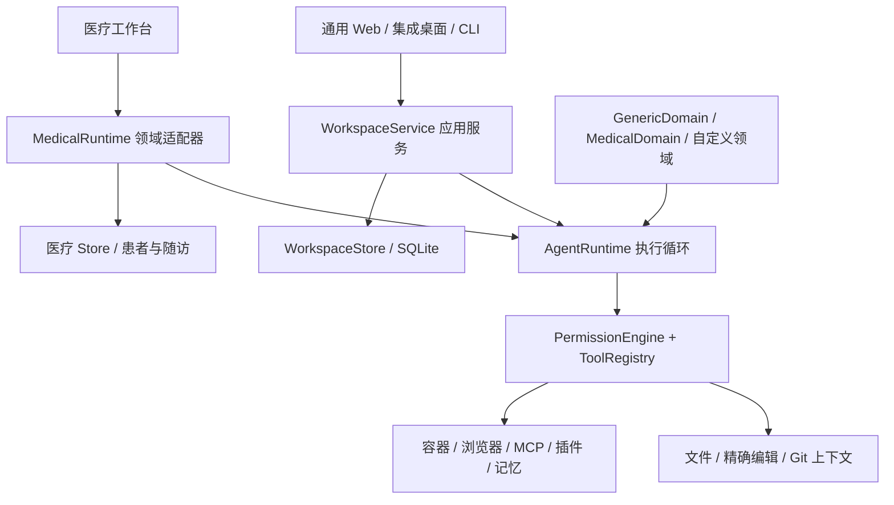

> 当前 0.7 实现与验收以 [GENERIC_PLATFORM_07.md](GENERIC_PLATFORM_07.md) 为准。本文保留历史版本记录。

# 通用 Agent 平台 0.6

本轮目标是「通用执行能力优先，医疗作为领域适配」。这是一个已可运行的单机平台版本，不是 Codex、Pi 或 DeepSeek Harness 的完整兼容实现。

## 入口与数据

```sh
npm run build
npm run platform
```

打开 http://127.0.0.1:8788。此入口只组装 `WorkspaceDatabase → WorkspaceService → AgentRuntime`，不会导入医疗运行时或创建患者表，默认数据库为 `~/.open-medical-workbench/platform.sqlite`。`AGENT_PORT` 可改变端口。

`npm start` 保留医疗集成服务（8787），桌面版和集成服务默认进入「通用 Agent」，医疗工作台仍是独立导航入口。现有医疗数据库不迁移、不删除。CLI 使用其原有独立数据库。

模型沿用 `.env`；独立 CLI 从进程环境读取。没有可用模型时，可以管理文件、Git、审批、终端和扩展，但不能完成模型驱动任务。容器需要本机 Docker 和已导入镜像；Node/Python 镜像仍可使用 0.5 的离线工具包。

## 分层与依赖方向



- AgentRuntime：模型轮次、工具调用、授权、事件、上下文预算、取消、完整工具批次检查点。核心模块不导入医疗领域。
- WorkspaceService：工作区、审批、持久历史、执行预算、后台运行、显式续接、子任务、计划及 Git 用户操作。
- 领域契约：`defineDomain({id, system, limits, registerTools, beforeTool, beforeComplete})`。只接受应用代码注册的可信函数。目录里的 AGENTS.md 和插件文本不能注册策略、扩大权限或修改内核。
- MedicalRuntime：仍负责患者材料、临床工具、产物复核和医疗调度；使用同一个 AgentRuntime，传入 MedicalDomain。医疗历史不自动压缩，现有医疗权限和草稿要求保留。通用 Code 模式可调用模型和只读子代理；医疗旧版 Code 计算的限制由 MedicalDomain 显式提供，不再作为通用 Code 的默认规则。
- 持久化采用状态快照 + 追加事件日志，不是完全由事件重建的 event sourcing，也不是分布式工作流引擎。

## 已接入的通用工作流

### 代码修改与验证

1. 读取根目录 AGENTS.md；读取具体文件时同时发现所属目录的嵌套 AGENTS.md。
2. `read_file` 支持行范围；返回完整文件 hash，避免用片段 hash 覆盖原文件。
3. `propose_file_edit` 精确替换，每段原文必须唯一匹配；`propose_file_write` 支持创建多层目录中的文件；`propose_file_delete` 只删除指定文本文件。
4. `revise_file_proposal` 撤销旧提案并创建新 ID，不原地替换已展示的批准对象。
5. `terminal_run({command, snapshot:true, approvalIds:[...]})` 把提案叠加到隔离快照，执行真实命令。测试失败时可修订提案再次运行；宿主文件没有提前改变。
6. 终端返回 running 时使用 `terminal_wait`。命令退出码、输入文件 hash、提案 ID 与执行环境保存在验证记录中。
7. 文件修改和删除仍经批准落盘；删除可通过新的回退提案恢复。Git 提交由用户明确选择文件和确认完成。

自动快照最多 500 个文本文件 / 10MB，过滤密钥、数据库、符号链接、node_modules、构建与发布目录。扫描过大时明确失败，不能把不完整项目当成全量测试。二进制和过大文件会列为 skipped。容器导出最多 20MB / 1000 个归档条目；node_modules 等运行时依赖不导出。

代码终端使用 1GiB 内存、1 CPU、256MiB 工作盘和每命令最多 5 分钟；插件通用容器维持较小默认配额。依赖在临时工作盘，容器退出即丢弃，可使用预装依赖的镜像。默认断网；用户可单独启用终端联网以下载依赖，授权覆盖容器可达网络，不是假定的域名级出口隔离。容器仍不获取模型密钥或宿主机可写挂载。

### 二进制输入和文件成果

`inspect_file` 返回授权文件的大小和 hash，不把二进制数据塞进模型文本上下文。`terminal_run` 的显式 paths 支持最多 10MB 的二进制输入，可由镜像中的 Python/Node 程序解析；自动项目快照仍以文本为主。

生成的 PDF、Office、图片、压缩包及其他二进制输出保存到应用数据目录的 `agent-artifacts`，界面可下载，`list_artifacts` 返回名称、大小、类型和 hash。成果不会覆盖工作区原件，不把 base64 注入模型上下文。下载接口为 `GET /api/workspaces/:id/artifacts/:artifactId`，检查归属和 hash，强制 attachment。

单成果最多 10MB，每工作区最多 100 份 / 100MB。保存成果需要已有文件写入授权。解析/生成软件取决于镜像已装依赖；本轮验证的是二进制输入与成果传递，不代表所有 Office/OCR 库都已内置，也没有新增视觉模型输入协议。

### Git

- `git_status`：分支、HEAD、文件状态与可提交文件 hash，隐藏受保护路径。
- `git_diff`：单文件 diff，关闭外部 diff、textconv、hooks 和仓库过滤器。
- `git_log`：最近最多 30 条提交摘要。
- 「创建隔离工作树」：绑定已展示的 HEAD，创建 `agent/name` 分支和独立目录。不复制源工作区的未提交修改，不继承写入授权或待审批记录。
- 「确认提交所选文件」：绑定 HEAD 和文件 hash。存在其他已暂存修改时拒绝操作。仅提交明确选择的文件，不推送远程。提交失败可能留下已暂存文件，错误和事件记录会明确要求检查索引。

Git 操作需要本机 Git；提交身份须在仓库本地配置 `user.name` 与 `user.email`（为避免继承全局 hooks/filters，本模块不读取全局 Git 配置）；工作区必须是仓库根目录。当前不提供 rebase、merge、push、远程凭据管理和工作树自动删除。原项目目录当前没有 `.git`，因此仓库行为使用独立临时 Git 仓库实测，未初始化或修改原项目 Git 历史。同机其他进程的并发 Git 写操作不构成受本应用控制的事务。

### 长任务与子任务

- 默认 32 轮 / 30 分钟，可设最多 128 轮 / 600 分钟；这是执行上限，不是持续运行 10 小时的稳定性认证。上下文默认 200000 字符，SDK/API 可在领域上限内调整到 1000000；不静默丢弃历史。
- Web 默认使用后台运行接口。关闭页面不会取消任务；关闭应用/进程会中断，系统休眠不会被唤醒。
- `update_plan` 持久化最多 20 步计划；不等于 DAG 自动调度，计划状态由 Agent 更新。
- `delegate_tasks` 并行运行 1–3 个独立只读子任务。父任务取消会传递，子任务不能编辑、写计划、开终端或再次委派。
- 完整 assistant/tool 批次保存检查点。最近一次失败/取消/中断任务可在同权限下显式继续，从新模型轮开始，不自动重放旧工具。更换模型或领域后不会继承旧私有上下文。半个工具批次不作为检查点；模型仍需重新判断下一步，不能宣称精确恢复外部进程现场。
- 模型试图在当前终端尚未结束时完成任务会被拒绝，避免后台进程被遗漏。

## API 与 CLI

原有 `/api/workspaces` 接口继续支持。新增：

| API | 作用 |
| --- | --- |
| GET `/:id/capabilities` | 当前领域、预算、实际可用工具 |
| POST `/:id/runs` | 后台执行，202 返回 runId |
| POST `/:id/worktree` | consent、revision、expectedHead、branch 创建工作树 |
| POST `/:id/commit` | consent、revision、expectedHead、message、files[{path,hash}] 本地提交 |

执行请求支持 `limits: {maxRounds,maxContextChars,timeoutMs}` 和 `resumeRunId`；原 SSE `/run` 接口保留断线取消语义。纯通用服务接受 `X-Agent-Token`，兼容现有前端的 `X-Medical-Token`；两者都使用 bootstrap 返回的本机随机令牌。

```sh
npm run workspace -- capabilities --workspace=ID
npm run workspace -- run --workspace=ID --message='修复失败测试并验证提案' --allow-model --max-rounds=64 --timeout-minutes=60
npm run workspace -- run --workspace=ID --message='继续任务' --allow-model --resume-run-id=RUN_ID
npm run workspace -- worktree --workspace=ID --branch=agent/task --expected-head=SHA --allow-git
```

`npm run workspace --` 显示完整命令。Git 写操作的授权标志不能由模型工具直接触发。

## SDK 领域适配

```js
import { WorkspaceService, defineDomain } from './server/core/index.mjs';

const domain = defineDomain({
  id: 'research',
  system: '你是资料研究助理，使用可核对来源。',
  limits: { maxRounds: 64, maxContextChars: 300000 },
  beforeTool({ name }) {
    if (name === 'propose_file_delete') throw new Error('领域策略禁止删除');
  },
  registerTools({ registry, workspace, runId }) {
    // 在此用 registry.register 注册应用提供的领域工具。
    // execute 回调由可信应用代码提供；权限仍由内核检查。
  },
});
const service = new WorkspaceService(database.db, provider, { domain });
```

此接口是项目内 SDK，还未单独发布 npm 包、提供 semver 兼容保证或第三方插件市场。医疗是现有领域适配器，并未把患者业务强行塞进通用 WorkspaceService。

## 验证方式和边界

本轮实际验收记录见 [PLATFORM_ACCEPTANCE.md](PLATFORM_ACCEPTANCE.md)。

```sh
TEST_DOCKER_IMAGE=open-medical-runtime:0.5-arm64 npm run check
npm run verify:model
npm run package:mac
npm run verify:desktop
```

自动化新增覆盖：精确编辑歧义、嵌套新建、删除恢复、指令作用域、领域策略与自定义工具、检查点续接、并行子任务、真实 Git 工作树/提交、拒绝用户已暂存变更、纯通用 API 与后台运行，以及真实 Docker 中的「失败测试 → 修复提案 → 快照验证成功 → 批准写入」。原有医疗测试继续执行。

实机界面使用合成模型和临时工作区验证：打开工作区、后台提交、查看结果、刷新后读取历史。真实 Docker 终端和 stdio MCP 单独启用测试，不能用默认跳过结果代替通过。

当前未提供真实模型密钥，`verify:model` 明确未执行。Windows 实机、跨机器完整安装、10 小时负载、远程插件生态、任意格式 OCR/Office、多用户、临床有效性没有完成本轮验收。不能称为「任何事情都能实现」或与参照产品完全等价。
