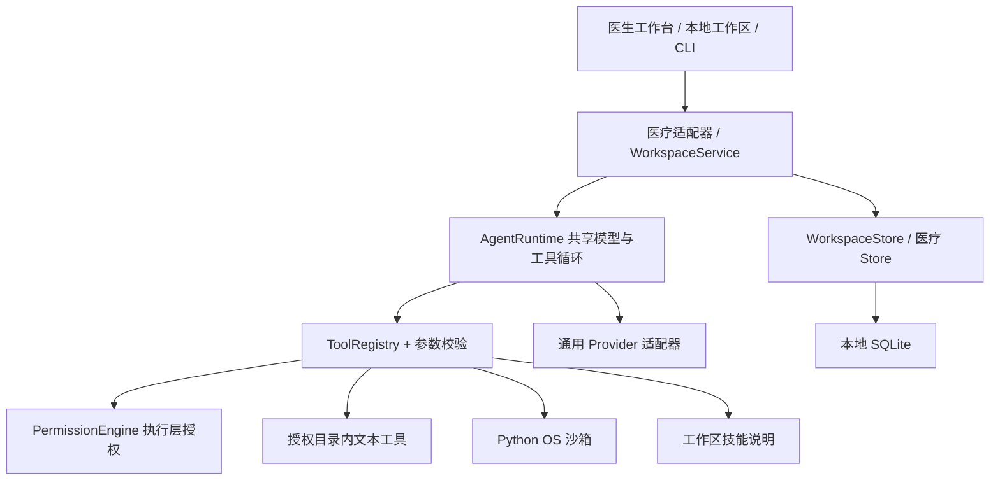

> 0.6 当前通用平台实现、Git/终端新能力与验收边界见 [GENERIC_PLATFORM_06.md](GENERIC_PLATFORM_06.md)。以下保留先前版本设计说明；与 0.6 冲突时以新文档为准。

# 通用单机内核 · 0.5（2026-09-10）

这一版将共享执行循环从医疗业务中抽出，提供可独立使用的通用工作区。它不是 Codex、Hermes 或 DeepSeek Harness 的全量复刻，也没有声称兼容其私有协议。0.5 已补齐本项目范围内的 MCP、插件、终端、浏览器、跨平台容器和语义记忆链路；本文件 0.4 的旧表格仅描述基础层，以下更新表为准。

## 使用入口

桌面或浏览器左侧选择「本地工作区」。输入本地文件夹的绝对路径并确认授权；桌面版还提供原生文件夹选择器。默认只能读取目录和文本，修改需要先开启写入提案权限，再逐项查看、批准。通用工作区与患者档案使用不同的数据表；创建通用工作区不会创建患者或医疗会话。

模型配置沿用运行设置。无模型时可浏览文本、手动提出修改和审批；对话需要实际的模型服务。本地 OpenAI-compatible 服务可配置：

```dotenv
AI_PROVIDER=local
LOCAL_MODEL_BASE_URL=http://127.0.0.1:11434/v1
LOCAL_MODEL_NAME=your-installed-model
```

本地模式不要求 API Key，只接受回环地址，不跟随重定向。推理引擎和模型文件需要另行安装，不随软件打包。每次模型任务均需确认可发送本次输入、同授权下的历史和工具读取内容。

## 分层实现



- `server/core/agent-runtime.mjs`：不导入医疗代码；实现模型流、工具续轮、上下文与轮数预算、用量回调、取消和执行事件。医疗与通用工作区均实际调用该类。
- `server/core/providers.mjs`：DeepSeek、OpenAI-compatible、Anthropic、本地兼容服务。旧导入路径保留兼容转出。
- `server/core/tool-registry.mjs`：工具执行前强制提供授权上下文，并验证参数。支持的 JSON Schema 子集以 `schema.mjs` 为准，不认识的约束拒绝注册，不假装完整支持。
- `server/core/permissions.mjs`：模型、文件读写、工具、沙箱、子任务、插件、MCP、浏览器、记忆和进程权限。所有扩展默认关闭，配置变更会撤销待审批动作并暂停计划。
- `server/core/workspace-store.mjs`：`agent_workspaces` / `agent_events`，与患者域分开；持久化消息、执行、修改提案、计划。重启标记中断，不自动重放可能产生副作用的动作。
- `server/core/workspace-files.mjs`：相对路径解析、拒绝目录越界和符号链接、受保护配置/数据过滤、文本读取、检索、版本哈希和修改提案。
- `server/core/workspace-scheduler.mjs`：单次或固定分钟间隔任务，绑定目录授权及模型身份；发生变化时暂停。执行期间不重叠，错过多个周期只补一次。
- `server/domains/medical.mjs`：医疗系统规则、策略、材料来源和业务工具入口；医疗复核、患者与随访继续由医疗适配器管理。

## 实际支持的操作

| 能力     | 行为及边界                                                                                                                                                                              |
| -------- | --------------------------------------------------------------------------------------------------------------------------------------------------------------------------------------- |
| 本地目录 | 读取当前授权目录；拒绝符号链接、越界和常见密钥/数据库路径。不是对同机恶意进程的 OS 级文件隔离                                                                                           |
| 文本文件 | 单文件不超过 500KB；不是通用二进制、Office 或扫描 PDF 编辑器                                                                                                                            |
| 文本检索 | 字面匹配、路径及行号；有目录/文件/输出预算，达到上限显式标记 truncated；不是语义 RAG                                                                                                    |
| 文件修改 | 完整内容提案；批准绑定原路径、内容和原文件哈希；版本变化、撤权、重复批准均拒绝                                                                                                          |
| 修改回退 | 对已修改的现有文本生成新的回退提案，再次批准；不自动删除新建文件                                                                                                                        |
| 历史分支 | 可从指定已结束运行截点复制可见对话，继续模型上下文；不复制文件夹或继承待审批动作，写入权限关闭；不是 Git worktree                                                                       |
| 执行事件 | SQLite 游标分页读取，SSE 实时通知；不是任意事件截点恢复或副作用重放                                                                                                                     |
| 运行恢复 | 记录成功/失败/取消/中断和部分文本；可在保留历史的工作区继续提问，不能精确恢复任意工具的执行现场                                                                                         |
| 子任务   | 独立上下文、父任务目录作用域，只读，不可递归；每父任务最多 3 个，取消联动，用量汇总                                                                                                     |
| 模式     | Minimal/Standard/Creator/Code 是现有工具的权限预设；不是参照产品四种完整工作流的等价实现                                                                                                |
| 技能     | 发现并读取授权工作区 `skills/<name>/SKILL.md`；不自动执行脚本、Hooks 或安装远程插件                                                                                                     |
| 计划     | 单次或固定间隔、暂停与重新授权恢复；应用需运行；无 cron 表达式、DAG 或系统唤醒                                                                                                          |
| 沙箱     | 医疗计算使用 macOS Seatbelt；通用终端和插件命令使用本地 Docker Linux 容器，网络关闭、只读宿主挂载、256MiB/1CPU/64进程/5分钟上限；没有 Docker 时 fail-closed                             |
| MCP      | 官方 TypeScript SDK 的 stdio、Streamable HTTP、SSE；工具分页发现、JSON Schema（draft 7/2019/2020）、resources、prompts、来源限制、响应上限；stdio 运行在隔离容器，HTTP 非本机必须 HTTPS |
| 插件     | 离线 `plugin.json` 清单、摘要校验、安装/升级/启停/卸载；技能、命令和 MCP 入口分开授权；不执行 hooks、不安装依赖或市场脚本                                                               |
| 通用终端 | 交互 stdin、输出游标、取消；选定文本文件进入 `/input` 只读快照，写入 `/work` 内存盘，成功结果转换为逐项文件提案                                                                         |
| 浏览器   | Electron 独立 Chromium 会话或 Playwright；来源白名单、禁止下载/弹窗/密码文件输入、点击/填写待用户批准，拒绝跨来源和重定向                                                               |
| 语义记忆 | 每工作区最多 256 个分片；离线 LSA 或本机 Ollama/OpenAI-compatible 嵌入，余弦检索、来源 hash/有效期/模型命名空间、删除和重建索引                                                         |

文件修改采用临时文件和替换，保留原文件权限。原文件内容保存在本地审批记录中；数据库未加密。本地 API 认证防跨站请求，不能抵御已控制本机的程序。文件系统检查与替换不是针对同机恶意进程的完整抗竞态安全沙箱。

## 独立 CLI 与代码接口

无需启动医疗 HTTP 服务即可使用通用 CLI。它默认使用 `~/.open-medical-workbench/agent.sqlite`，不会创建患者表：

```sh
npm run workspace -- create --root=/absolute/project --title=Research
npm run workspace -- list
npm run workspace -- show --workspace=WORKSPACE_ID
npm run workspace -- run --workspace=WORKSPACE_ID --message='读取 README 并整理摘要' --allow-model
npm run workspace -- permissions --workspace=WORKSPACE_ID --profile=standard --write
npm run workspace -- approve --workspace=WORKSPACE_ID --approval=APPROVAL_ID --revision=REVISION --decision=approve
npm run workspace -- fork --workspace=WORKSPACE_ID
npm run workspace -- events --workspace=WORKSPACE_ID --after=0
```

CLI 从进程环境读取模型配置，不自动读取项目 `.env`。通过 `--database=/absolute/path.sqlite` 指定独立数据文件。事件写到 stderr，命令结果为 stdout JSON。已有数据库 owner 运行时拒绝第二个进程，避免互相把运行状态误判为中断。CLI 是单次命令，不充当后台计划守护服务。

代码使用入口为 `server/core/index.mjs`，导出 `AgentRuntime`、`ToolRegistry`、`PermissionEngine`、`WorkspaceService`、`WorkspaceStore`、`WorkspaceDatabase`、模型适配器和 `PythonSandbox`。这是一套本项目接口，尚未发布稳定的第三方 SDK 包。

## HTTP

所有接口复用本地认证、Host/Origin 检查和请求体预算。

| 接口                                             | 用途                           |
| ------------------------------------------------ | ------------------------------ |
| GET/POST `/api/workspaces`                       | 列出/创建工作区                |
| GET/PATCH `/api/workspaces/:id`                  | 获取/调整授权（须带 revision） |
| POST `/api/workspaces/pick-directory`            | 桌面原生目录选择器             |
| POST `/api/workspaces/:id/tools`                 | 受控手动工具调用               |
| POST `/api/workspaces/:id/run`                   | 带外发确认的 SSE 任务          |
| POST `/api/workspaces/:id/cancel`                | 停止父任务与子任务             |
| POST `/api/workspaces/:id/approvals/:aid`        | 批准/拒绝固定提案              |
| POST `/api/workspaces/:id/approvals/:aid/revert` | 生成回退提案                   |
| GET `/api/workspaces/:id/events?after=N`         | 分页读取事件                   |
| POST `/api/workspaces/:id/fork`                  | 从指定 runId 或最新历史分支    |
| POST `/api/workspaces/:id/schedules`             | 创建单次/间隔计划              |
| POST `/api/workspaces/:id/schedules/:sid`        | 暂停或重新授权恢复             |

## 仍有限制

本轮已实现的扩展会在没有明确授权时 fail-closed。Docker 镜像和本地嵌入模型需要用户预先导入；离线工具包包含两种架构镜像、导入脚本、校验清单和示例插件，但不包含 Docker Desktop、操作系统或语言模型。Mac 桌面普通启动和 ARM64/x64 Linux 断网容器验收已实际完成；当前没有 Windows 实机/虚拟机，Windows 只能验收包结构，不能声称安装运行通过。Mac 在外层 Seatbelt 下运行 Chromium 会与 Chromium 自身沙箱初始化冲突，因此未通过关闭浏览器沙箱来伪造断网验收。Git worktree、cron/DAG、远程插件市场、自动模型下载和参照产品私有协议不在本项目 0.5 接口中。
