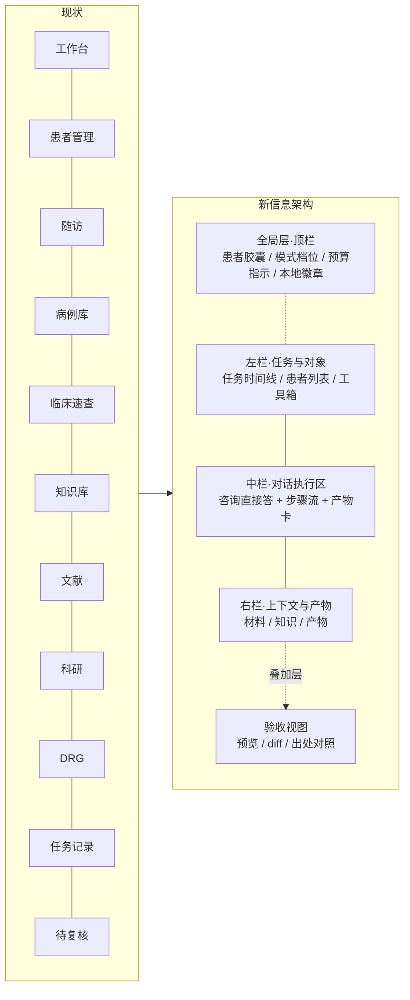
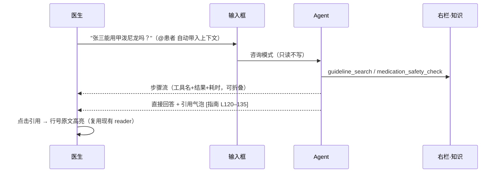
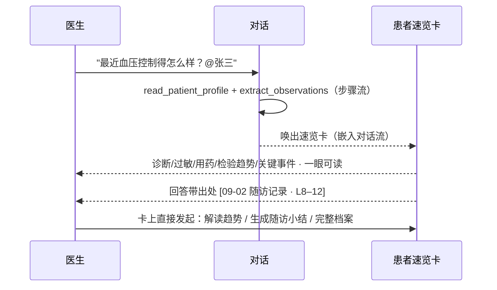
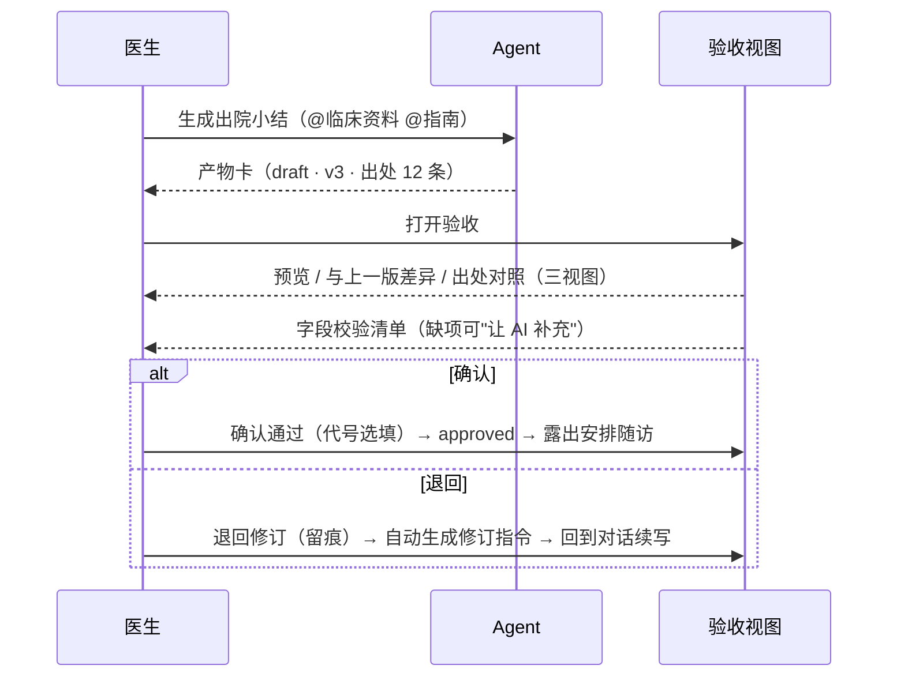

# Open Medical 工作台 · 交互重设计方案 v1.1

更新：2026-09-15（v1.1：按产品负责人定调的三条核心原则重排——对话式入口连接一切功能、患者信息查看第一优先、文献/科研/溯源为证据层嵌入；新增屏 2 患者速览卡）
配套高保真设计稿：[docs/interaction-mockup.html](./interaction-mockup.html)（浏览器打开，可用 `#shot0`–`#shot5` 逐屏查看）
参考调研：[ZCode / Codex / WorkBuddy 产品调研](./research-agent-products-zcode-codex-workbuddy.md)

---

## 一、现状问题（为什么重设计）

基于对现有前端与文档的勘察（结论均可在代码中定位）：

| # | 问题 | 现状证据 |
|---|---|---|
| 1 | **11 个平级页签没有任务动线**，完成一件事要跨页：文献结果要"导入→新建会话→跳转"才能被 AI 使用；知识库检索与对话不互通 | `main.jsx:1045-1056`（scenario-tabs）、`literature.jsx:71-86` |
| 2 | **两套割裂的对话 UI**：医疗会话（亮色）工具过程只有文本日志；项目 agent（暗色）有 RichMessage/步骤折叠/diff 审批，两者能力不对齐 | `main.jsx:83-114`（文本日志）vs `workbench/activity.jsx:23-96`、`workspaces.css:295-302`（暗色 token） |
| 3 | **复核是长表单且无 diff**：代号+说明+下拉+承诺勾选，医生看不到"AI 改了什么" | `main.jsx:429-477`；diff 视图只存在于项目工作区 `workspaces.jsx:1479-1484` |
| 4 | **表单工具与 agent 割裂**：临床速查/DRG/科研/随访是纯表单页，与对话零交互 | `clinical-ref.jsx:18-23`、`drg.jsx:84`、`research.jsx:97` |
| 5 | **执行过程不可在对话内追溯**，要看右栏"执行记录" tab | `main.jsx:1652-1656` |
| 6 | 设计 token 少、两套主题并存、`.shell` 三列死代码 | `style.css:1-14, 172-178, 2318` |

## 二、设计原则（产品负责人定调三条为纲，其余为支撑）

**三条核心原则（定调，2026-09-15）：**

1. **对话式入口，能连接一切功能。** 任何功能都必须能从对话发起或调用，不存在对话到不了的功能孤岛；功能页只是对话的备选入口。这是检验每个设计的第一问。
2. **前端交互为用户友好度服务，第一优先是患者信息查看。** 患者速览、趋势、时间线要做到"一眼可读"；查看信息永远比录入信息更优先。
3. **医疗文献、科研、内容溯源等，前端只是把它们更友好地嵌入场景。** 它们是证据层——引用气泡、出处角标、检索面板等嵌入式组件，不是独立目的地。

**支撑原则（从三款对标产品提炼）：**

4. **执行透明，结论可溯**（WorkBuddy 阶段说明 + 现有行号 reader）：步骤流可展开、每个结论带出处、点击看原文——这正是原则 3 的实现手段。
5. **交付可验收**（WorkBuddy 右栏产物区 + Codex diff 审查）：文书一律走草稿，验收=预览/diff/出处对照三视图 + 字段清单 + 轻量复核条。
6. **分档授权，本地默认**（Codex/ZCode 审批档位 + WorkBuddy 本地卖点）：四档模式，患者数据留在本机写进界面而不只是文档。
7. **上下文可视**（对应产品上限=预算+压缩+检索）：顶栏常驻三个指示器。

> 评审清单：任何新功能/新界面，先过三条核心原则——能否从对话直达？患者信息是否一眼可读？文献/科研/溯源是否以嵌入组件服务场景？

## 三、信息架构：11 个平级页签 → 1 个工作台 + 3 个支撑面板

各去留：

- **保留为视图**（从页签降级为左栏入口）：首页（今日概览）；患者详情页降为**兜底**——第一入口是对话内 `@患者` 速览卡（见屏 2），完整档案只在需要编辑/全量浏览时打开。
- **收纳进工具箱**（点击右滑工具面板，见屏 5）：临床速查、DRG、科研、文献检索、病例库相似检索——它们同时注册为对话可调用的技能/命令，满足原则 1。
- **升格为全局机制**（不再是页面）：待复核 → 顶部徽章 + 任务时间线状态点 + 验收队列；知识库 → 右栏"知识"tab + `@指南` 引用；任务记录 → 左栏任务时间线；随访 → 从已复核产物与患者详情发起（保留现有闭环）。

## 四、核心交互流程

### 4.1 咨询直接答（屏 1）

要点：咨询模式**只读不写**，这是"咨询直接答"的安全边界；回答中的每个关键结论可携带引用气泡。

### 4.2 对话内查患者：患者速览卡（屏 2）

要点：`@患者` 即达，不切页；速览卡是**只读摘要**（原则 2 的载体），后续功能全部从卡上发起；患者管理页保留完整档案与编辑，退为兜底。

### 4.3 文书草稿与验收闭环（屏 3）

要点：**退回不是终点而是指令**——现有"编辑后自动回到 draft"（`PRODUCT_DESIGN.md`）升级为"退回原因直接变成下一轮的修订输入"；diff 复用项目工作区已有的 DiffView。

### 4.4 Goal 式长文书（屏 4）

借鉴 ZCode Goal / Codex goal mode：目标卡列出章节清单 × 完成证据，每轮自动校验、只认实据（已写入草稿的内容、已通过的核查），未达标自动续跑，全部达成自动进入待复核队列。可暂停/手动接管。适用于出院小结、病历时间线等多章节文书。

### 4.5 工具汇入对话（屏 5）

临床速查等表单工具从左栏工具箱点开，右滑工具面板（对话不中断）；工具自动读入患者数据预填；结果卡可"生成评估记录（草稿）"，汇入与文书相同的验收闭环。**表单起点，对话续写，同一套产物管理。**

## 五、关键组件规格

| 组件 | 规格 | 对标来源 |
|---|---|---|
| **患者速览卡** | 对话内 `@患者` 唤出：卡头（诊断/术后/过敏+本地徽章）+ 三列（当前用药 / 检验数字+趋势线 / 关键事件时间线）+ 卡上动作（解读趋势 / 生成随访小结 / 完整档案）；只读摘要，数据源=患者概览+临床资料 API | 原则 1+2 的核心载体 |
| 输入框符号体系 | `@`患者/资料/指南、`/`命令、`$`技能、`+`附件；上下文 chips 显示在输入框上方可移除 | ZCode @/#//$ |
| 模式档位 | 输入框右下：**咨询**（只读默认）→ **文书**（可写，产物一律 draft）→ **计划**（先出方案不动手）→ **自动**（本地工具连续执行，高危仍确认） | Codex 审批三档 / ZCode 四档 |
| 步骤流 | 对话内折叠组件：工具名 + 结果摘要 + 耗时，默认收起最近 3-5 步，可展开全部 | workbench/activity.jsx 已有实现，移植到亮色主题 |
| 引用气泡 | 结论内联 chip：`📄 文档名 · L120–135`，点击进行号原文高亮——**文献与溯源的证据层形态**：不出现在独立页面，而以嵌入组件随结论出现 | 现有 knowledge.jsx 行号 reader |
| 产物卡 | 对话内嵌：draft/approved 徽章 + 版本 + 出处数 + [打开验收视图] | WorkBuddy 产物区 |
| 验收视图 | 中栏叠加层：预览 / diff / 出处对照 三视图 + 右侧字段校验清单 + 底部复核条（代号选填、退回留痕） | Codex diff + WorkBuddy 右栏 |
| Goal 卡 | 章节 × 证据清单、校验轮次、暂停/接管 | ZCode Goal |
| 顶栏指示器 | 上下文占用 %、token 预算 %、检索命中数；本地数据徽章 | 产品上限=预算+压缩+检索 |
| 工具面板 | 右滑 332px 面板，表单自动预填，结果可生成草稿 | WorkBuddy 工具集成 |

## 六、与现有代码的迁移路径

按依赖顺序分四步，每步独立可交付：

**第 1 步：统一对话底座（消灭两套 UI）**
- 把 `src/workbench/` 的 `message.jsx`（RichMessage）、`activity.jsx`（步骤流）、`artifacts.jsx` 移植进医疗亮色主题，替换 `main.jsx` 的 message-list 与文本行日志（`main.jsx:83-114, 1257`）。
- 清理 `.shell` 死代码（`style.css:172-178`），收敛设计 token（`style.css:1-14` 扩展为完整 token 集，暗色 `--desk-*` 退役）。

**第 2 步：右栏改造为"材料 / 知识 / 产物" + 患者速览卡**
- 现 inspector 三 tab（`main.jsx:1641-1673`）中"执行记录"取消（步骤流已在对话内）；"材料"保留范围选择；新增"知识"tab：复用 `/api/knowledge/search`，命中卡带行号 + [引用进对话]。
- 产物 tab 汇集当前会话 artifacts，draft 徽章 + 验收入口。
- **患者速览卡**：composer 的 @ 提及机制（`main.jsx:1407-1437`）扩展到患者实体，选中后在消息流渲染只读速览卡；数据源用现有患者概览与临床资料接口（`patients.jsx` / `patient-clinical.jsx` 的读路径），卡上动作复用现有"打开病例工作区/随访"入口。

**第 3 步：验收视图替换复核长表单**
- `main.jsx:429-477` 的复核表单重构为验收视图；diff 复用 `workspaces.jsx:1479-1484` 的 DiffView；出处对照复用 ArtifactView 已有 provenance（`main.jsx:167-195`）。
- 复核接口不变（`/api/sessions/{id}/artifacts/{id}/review`），仅前端收敛为"确认/退回+选填代号"；退回时把说明写入会话作为修订指令。

**第 4 步：导航收敛 + 工具箱 + 模式档位**
- 移除 11 个 scenario-tabs（`main.jsx:1044-1077`），左栏改为任务时间线 + 患者列表 + 工具箱；临床速查/DRG/科研/文献迁入工具箱滑出面板。
- composer（`main.jsx:1406-1639`）增加 `@`//`$` 符号体系与四档模式；现有"本地/智能模式 select"（1554-1571）与外发同意勾选（1608-1617）并入档位语义（自动档仍逐次外发授权）。

## 七、医疗场景的坚守（不因对标而放弃的约束）

1. **复核仍是流程必需**：approved 才能安排随访；复核记录保留"不代表医生身份认证或临床签名"声明（`main.jsx:472`）。
2. **高危操作二次确认**：写入档案、删除、外发在所有档位下都要确认；患者工作区不可从任务侧删除（`PRODUCT_DESIGN.md`）。
3. **出处必须可溯**：文书里的关键结论默认带出处角标；无出处的段落标记"待核查"。
4. **失败与中断保留运行记录**；逐次外发授权不因"自动档"而豁免。
5. **示例数据全部为合成**，患者数据本地处理的主张在界面上常驻（顶栏徽章）。

## 八、开放问题

1. 患者下"任务层"（`PRODUCT_DESIGN.md` 后续扩展 #1）与任务时间线的合并粒度——时间线节点是 Session 还是未来新增的 Task？
2. 验收视图在窄屏/移动端折叠形态（先做中栏叠加层，移动端退化为全屏页）。
3. 模式档位与现有"本地/智能"运行模式的合并语义（建议：运行方式是档位的属性而非并列开关）。
4. 工具面板的结果卡进入验收闭环后，患者档案的 pending-actions（`patients.jsx:594-628`）是否统一并入同一队列——建议并入，形成唯一的"待复核"收口。
