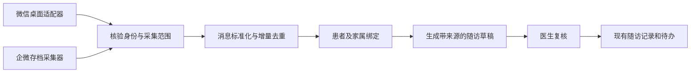

# 微信与企业微信随访接入选型

调研日期：2026-09-25。状态：源码与接口调研完成；对应实现已落地，见[使用说明](../chat-followups.md)；真实企业 SDK 部署与真实账号联调尚未完成。

## 结论

微信采用可见桌面操作适配器，企业微信采用官方会话存档采集适配器。两种连接独立配置，统一进入患者会话绑定、增量消息、随访草稿和人工归档流程。企业微信客户联系与会话存档使用不同能力和凭据，现有客户联系连接器继续保留。

当前 macOS 应用已有原生桌面控制、窗口截图和本地 OCR 基础，可以在这些模块上实现微信适配；不能把依赖 Codex 宿主的工具当作应用自带能力。企业微信采集器与 Electron 分开部署，避免把平台相关的 SDK 动态库直接装进 Node 主进程。

## 开源项目比较

| 项目 | 已核实情况 | 适用方式 |
| --- | --- | --- |
| [JuneYaooo/wechat-desktop-automation](https://github.com/JuneYaooo/wechat-desktop-automation) | 公开仓库为 Windows PowerShell + Codex Skill；读取可见画面，未提供完整历史消息接口。当前树未见 LICENSE，GitHub 许可证字段为空。 | 优先参考会话查找、可见核验、有限监控及审计流程。直接分发脚本前需明确许可证；Mac 独立实现。 |
| [NICEXAI/WeWorkFinanceSDK](https://github.com/NICEXAI/WeWorkFinanceSDK) | Apache-2.0；基于官方 C SDK 的 Go 封装，README 声明 Linux 支持。提供消息获取、解密和媒体获取。 | 首选验证底座，构建独立采集器；SDK 动态库的架构、版本和分发条件另行核对。 |
| [Hanson/WeworkMsg](https://github.com/Hanson/WeworkMsg) | MIT；在上述 Go SDK 外提供 HTTP 和跨平台 CLI。 | 参考服务端/客户端拆分及 JSON 接口，不直接部署原样服务处理患者信息。 |
| [wenerme/go-wecom](https://github.com/wenerme/go-wecom) | Apache-2.0；覆盖多类企微 API，含会话存档 C SDK 绑定和 poller。 | 作为采集游标、部署方式和更广接口能力的备选；不替换已有 Node 客户联系 SDK。 |
| [chinayin/WeworkChatSDK](https://github.com/chinayin/WeworkChatSDK) | Apache-2.0；Java 服务，支持存档与媒体处理，现有方案关联阿里云 MNS/OSS。 | 适合已有 Java/队列基础设施的部署；当前桌面项目采用它会增加不必要的运行依赖。 |

本次通过 GitHub API 核对的提交：

| 仓库 | 提交 |
| --- | --- |
| JuneYaooo/wechat-desktop-automation | `7e58769c372b837a977785c5fcdc1ac14be88b74` |
| NICEXAI/WeWorkFinanceSDK | `14e5b390af12bd4c8bff490d201e872b7965811b` |
| Hanson/WeworkMsg | `543a427a886d3abe9fd599f727128b1a4a4a82bc` |
| wenerme/go-wecom | `16c85f1beb80b1f9fc54dfa1c86eb7563f3b4962` |
| chinayin/WeworkChatSDK | `cf68a7a348d05b7c4380bb5cc5b6cbbcfd2a3723` |

网页源码审查使用调研时 main 页面；上表用于后续下载和固定版本复核。未安装或运行第三方二进制。

### 微信参考项目的集成边界

[PowerShell 脚本](https://github.com/JuneYaooo/wechat-desktop-automation/blob/main/scripts/wechat_desktop.ps1)返回截图和操作结果，不直接返回结构化聊天消息。截图识别、会话身份判断与摘要依赖上层执行者。画面哈希变化也不等于新增消息，需额外做消息级去重。

脚本中的发送授权主要检查确认字符串或非空规则 ID；完整规则有效性需要上层执行。本次随访读取适配器只暴露查找、打开、读取、取消，发送不进入同一个命令通道。

[公开 SKILL](https://github.com/JuneYaooo/wechat-desktop-automation/blob/main/SKILL.md)要求先识别搜索结果，再打开并核对会话，不能默认选第一个同名结果。Mac 本地同名技能依赖 Codex 的 `cua` 工具，与公开 Windows 实现及应用内原生组件是三个不同运行环境。

### 企业微信参考服务的集成边界

[WeworkMsg 的 main.go](https://github.com/Hanson/WeworkMsg/blob/main/main.go)提供 `/get_chat_data`、`/get_media_data`。本次检查的处理器未见鉴权、请求体大小约束，监听地址为所有接口；媒体内容在内存累积。不能据此认定整个项目通过安全审计。

拟实现的采集器增加连接鉴权、请求与媒体大小限制、超时、健康状态及有版本的协议。默认回环监听；远程连接使用 HTTPS 与独立凭据。私钥留在采集器，不发送给模型。支持按公钥版本选私钥及失败重试，不能固定一把私钥处理全部历史消息。

## 配置与页面位置

“设置 → 随访连接”采用两个独立配置页。它们按微信账号或企业隔离，与项目浏览器、终端授权分开。

| 配置 | 微信桌面 | 企业微信会话存档 |
| --- | --- | --- |
| 连接身份 | 本机客户端、操作系统、账号标识、显示名称 | 企业 ID、采集器地址、连接凭据 |
| 就绪检查 | 登录状态、窗口可读性、辅助功能与录屏状态、会话核验能力 | 采集器认证、SDK 可用性、企业匹配、存档范围与凭据状态 |
| 范围 | 明确绑定的个人或群会话、读取时间范围、滚动上限 | 获准成员与客户范围、绑定会话、可用存档区间 |
| 同步方式 | 手动同步；通过实机验证后开放有限时段的自动整理 | 手动拉取；配置完成后可启用增量轮询 |
| 运行反馈 | 待登录、待授权、待核验、正在读取、被用户中断、部分读取 | 未配置、未连接、权限不足、已同步、部分失败、存档缺口 |
| 控制 | 开始、取消、暂停自动整理、解除连接 | 测试连接、同步、暂停、重置连接 |

“保存配置”与“测试连接”分开；保存不能显示为已接通。更换账号或企业后必须重新核验绑定。平台不支持时显示原因，不放置无效的同步按钮。

随访页面增加“聊天随访”：患者卡片显示本人/家属会话、最新同步时间、待复核草稿数。具体动作是“关联会话 → 同步聊天 → 查看来源与草稿 → 确认归档”。医生不需要进入终端或技能配置完成这条动线。

## 统一处理流程

连接器只输出观察到的消息，不直接改写病历或标记随访完成。聊天中出现的操作要求视为消息内容，不能成为工具执行指令。使用外部模型整理与读取本地聊天分别授权；未授权外发时可保留本地采集和人工整理。

### 会话与患者关联

- 显式保存渠道、账号/企业、会话标识、显示名称、关联患者、本人/家属关系、核验时间与版本。
- 一个患者可有多个联系人；一个家属也可能照护多位患者。多患者会话进入待分配区，不按姓名或既往绑定把全部消息归给单个患者。
- 微信拿不到稳定账号或会话标识时只能保存暂定绑定，需要再次核验；不能用聊天标题充当永久唯一标识。
- 打开会话前后均核验身份。重名、标题变化、前台变化、用户操作或锁屏时暂停。只执行已授权的会话队列，提供立即停止。

### 消息、游标与证据

标准消息保存 `channel`、`accountId`、`conversationId`、`sourceMessageId`、`senderId`、`speakerRole`、`sentAt`、`observedAt`、`text`、`evidenceId`、`confidence` 和读取范围。未知发送者、方向或时间保留未知，不能以读取时间冒充发送时间。

企微以企业、会话和消息 ID 去重；`seq` 用十进制字符串或 BigInt 保存，避免 uint64 转 JavaScript Number 丢精度。每页消息提交成功后再推进游标；摘要失败只重试摘要。游标属于采集流，不属于单个患者。解绑后的新消息不继续归档到原患者。

微信没有可靠消息 ID 时，结合会话、发送者、可见时间和相邻消息做窗口重叠匹配。相同“好的”可能是不同消息，不能永久按正文哈希丢弃。无法判断重复或归属时保留待核验，不宣称实现无损同步。

截图限制为目标窗口或必要区域，记录裁剪和消息定位。窗口外私人内容不进入模型；本地 OCR 优先，截图留存期限可配置。语音、图片、撤回、引用消息须保留类型和处理状态，未完成识别的内容不能进入摘要作为事实。

## 当前代码需要改动的地方

| 模块 | 当前情况与改造 |
| --- | --- |
| `src/app-settings.jsx` | 增加“随访连接”分类，两套配置分别保存与测试，不混入项目工具权限。 |
| `src/followups.jsx`、`src/followup-records.jsx` | 增加会话绑定、同步进度、证据预览、草稿复核与归档；保留现有计划队列。 |
| `src/patients.jsx` | 将现有“同步当前微信窗口”迁移到核验后的绑定流程，避免继续默认搜索首个结果。 |
| `server/wechat-bridge.mjs` | 现有实现遍历窗口文本、统一记为入站并以当前时间入库，缺少会话核验。替换为只读采集状态机；旧发送不能随读取升级自动启用。 |
| `desktop/native-control.swift`、`server/core/desktop-control.mjs` | 已有 AX、窗口定位、受限操作和截图。需增加微信窗口/弹窗识别、稳定元素信息、采集期间的前台与身份核验、取消支持；不能只复用坐标。 |
| `desktop/native-ocr.swift` | 已有中文本地 OCR，但只输出文字和置信度；需返回坐标，支持区分标题、消息区、左右气泡和原文定位。 |
| `server/wecom.mjs` | 继续负责客户联系。新增独立存档适配器，复用明确的本人/家属关系，不能把 `chatArchive: false` 直接改成 true。 |
| `server/patients.mjs` | 扩展消息来源、发言人和多患者分配。当前入站摘要固定写“患者发来”，需改为保留本人、家属转述和未知身份。导入最多 200 条，采集器需分批且事务化提交。 |
| `server/agent.mjs` | 复用现有患者消息与 digest 路由；新增连接、会话、采集任务和证据接口。采集到草稿的动作需要幂等标识与取消状态。 |
| `server/followups.mjs` | 复用现有联系记录、临床要点和追加更正机制；扩展企微渠道与消息证据关联，不自动设置“已完成”。 |
| `server/core/oauth.mjs` | 复用 CredentialVault 加密保存连接凭据；前端只返回是否配置，不回显密钥。 |

建议新增三类存储：连接与核验绑定、采集任务与检查点、原始消息及患者关联。来源消息与患者关联分离，才能处理家属对应多人、解除误绑定和重新分配。摘要使用固定消息快照，复核期间新增消息留到下一轮。

## 实施顺序与验证

1. 先实现独立连接设置、明确状态、患者/家属绑定和带来源的草稿数据结构。采集器未就绪时不提供假成功入口。
2. Mac 微信先验证登录检测、精确打开测试会话、仅读取消息区域、取消及错会话拒绝；完成手动同步后再开放有限自动队列。Windows 另行验证，不能由 Mac 结果推定通过。
3. 企微以 Go SDK 做受鉴权采集服务。先用合成响应验证消息标准化、超大游标、重启恢复、分页失败、重复消息与私钥版本，再使用测试企业验证真实 SDK/权限/存档范围。
4. 复用 digest 生成草稿，验证来源引用、家属归因、多人会话分配、并发消息快照和确认归档。模型不得根据缺失聊天补造结论。

关键失败场景：同名联系人、会话被手工切换、隐藏/最小化窗口、锁屏、权限撤销、滚动遗漏、OCR 不确定、重复文本、企业切换、令牌失效、解密失败、游标推进前崩溃、重复归档、患者删除与解绑、模型外发授权撤销。

调研尚未验证 Windows 实机、Mac 微信账号读取或企微真实存档拉取。真实联调需要非患者测试会话、企微存档权限及匹配平台的官方 SDK。自动整理和自动发送是独立功能，本方案只打通读取、整理、复核归档。

## 实现选择

桌面端使用项目自有的 macOS 原生控制与 Apple Vision；未复制分发参考仓库脚本。独立企微采集器使用 Python 标准库 ctypes 绑定官方 C ABI，调用本地 OpenSSL 解密消息随机密钥，避免额外引入 Go 或 Java 运行时。采集器源码和部署说明随安装包提供，官方 SDK 与企业密钥由部署环境配置。
