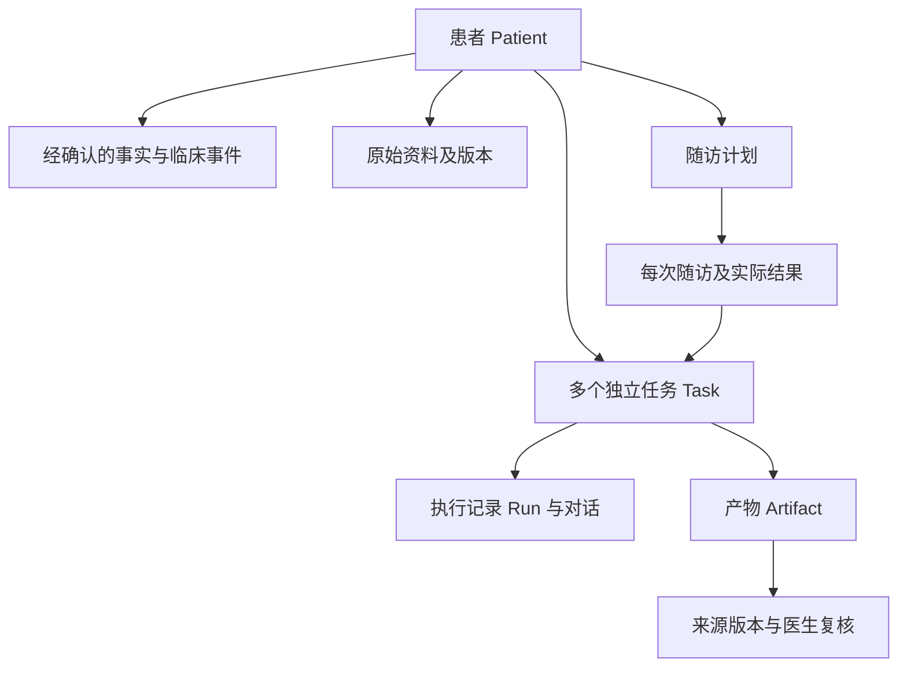

# 医疗工作台：定位、现状缺陷与改进路线

日期：2026-09-20；审阅版本：`2cb3182`，package 版本 0.9.7。拟归档位置：周分享记录 → 分享文档 → 医疗工作台设计文档。

**定位修订（同日，按产品负责人明确要求）**：底座坚持自研，吸收开源 Agent 的成熟机制；先达到通用 Agent 的能力与体验，再深化医疗场景。本文原先“优先采用外部 harness”的建议已撤回。后续实测和当前优先级见 [自研通用 Agent 底座实测与改进路线](自研通用Agent底座实测与改进路线_2026-09-20.md)。下面的医疗缺陷仍需记录，但不作为抢先扩展医疗功能的依据。

本文是基于当前源码、测试用例、设计文档和官方产品资料的产品与架构审阅，包含局部合成复现。没有进行真实医生访谈、真实病例验证、桌面可用性实测或竞品任务计时；交互判断属于代码与流程审阅，不能当作用户研究结论。优先级与验收阈值是建议，并非当前达成结果。

## 1. 核心判断

你的定位是成立的：基于持续进化的先进 Agent 基础能力，做深入医生工作场景、能持续管理患者的工作台，同时保持一句话交办、过程可见、结果可验收的简单体验。

当前项目最主要的偏差，是团队实际上同时承担了三件大事：建设通用 Agent 平台、建设患者管理系统、建设覆盖多个医学领域的工具集合。它们都已有真实实现，但维护面很宽，医生最常用的工作闭环还没有获得同等深度。继续增加通用能力或场景卡片，未必能提高医生的日常使用价值。

建议将产品定义收敛为：**医生交代任务，系统带着正确的患者上下文完成资料整理、文书和随访准备；医生在结果处核对，确认后的变化进入持续维护的患者档案。**

其中，Agent 执行能力由本项目自研，通过研究成熟开源实现、建立通用评测和持续打磨来提升；患者事实、资料版本、临床来源、业务状态和医生确认属于后续领域层核心资产。先验证通用任务完成率、操作负担和恢复体验，再验证医疗工作质量。

## 2. 当前已经具备什么

不能依据旧 README 把项目描述成只有简单聊天和正则抽取。当前代码明显领先于部分历史文档。

| 层次 | 当前证据 | 评价 |
| --- | --- | --- |
| 通用执行 | 自研 AgentRuntime、WorkspaceService、上下文压缩、工具注册、恢复、团队、浏览器、终端、MCP、插件等模块 | 有实质投入；但尚不能据模块数量认定与成熟产品体验等价 |
| 医疗融合 | 新医疗会话经 SessionBridge 使用 WorkspaceService，医疗 domain 注册核心工具与插件 | 已走向统一内核，不是完全分离的两个系统；旧会话仍双轨运行 |
| 患者档案 | 诊断、用药、过敏、检验、就诊记录、来源字段、患者消息、分组 | 已有结构化基础；长期事件与任务模型仍不足 |
| Agent 写回 | patient-create/update、followup-create、case-save 提案，医生确认后落库 | 是正确的业务控制方向，应加强版本与事务语义 |
| 医疗知识 | 指南库、向量/关键词检索、材料检索、文献、有限用药规则、量表 | 不是“没有知识能力”；核心问题转为覆盖范围、授权、质量与来源治理 |
| 交互 | 对话入口、患者速览、步骤流、Goal 卡、验收视图、工具箱、医生记忆 | 已有较好的设计基础，不宜再从头重画一套页面 |
| 验证 | 单元/API/协议测试、浏览器与 Electron E2E 文件 | 覆盖面较广；合成模型与历史验收不能证明真实医生任务质量 |

值得保留的是：来源引用、草稿复核、确定性工具、可撤销提案、执行记录和将医疗能力接入通用内核的方向。

## 3. 先解决的具体缺陷

### P0：患者材料可能经云端嵌入路径外发，授权边界不完整

源码链路：`server/agent.mjs:204,221,417` 创建并共享 embedder；`server/session-bridge.mjs:214` 在材料导入时调用 ingest；`server/medical/materials.mjs:21` 对文本分块后调用 embed；`server/medical/embeddings.mjs` 在配置嵌入 Key 后进入 cloud 模式，发送输入文本。

这条导入路径没有看到与患者材料绑定的外发授权检查。EmbeddingService 文件注释却称患者材料不会远程嵌入，两者不一致。不能把“对话发送前同意”当作已覆盖导入、索引和检索的全部外发。

局部复现：向真实 MaterialLibrary 和 EmbeddingService 注入 mock fetch，使用合成文本和假 Key，捕获到 cloud embedding 请求包含完整的合成患者片段。未发送网络请求、未读取真实患者数据。此复现证明调用路径，不代表当前机器发生过实际泄露。

**改进**：将公开知识与患者材料使用的嵌入配置拆开；患者材料默认仅本地处理。引入统一数据外发策略，覆盖生成、嵌入、搜索查询、插件和远程执行；授权记录包含对象、版本、用途、接收方、有效期。扩大范围或更换接收方才重新确认。导入本身不隐含云端处理许可。

**验收**：未授权患者材料在导入、检索、重建索引过程中，mock 外网接收器获得的患者文本为零；授权后仅发送选定版本范围。

### P0：摘要只消费一部分消息，却把全部未处理消息标为已处理

`server/agent.mjs:476` 的摘要流程最多读取 50 条，并按 12000 字符进一步裁剪；完成后调用 `server/patients.mjs:428`，SQL 按 patient_id 将全部 processed=0 的消息更新。`server/followups.mjs` 的自动摘要也有相同的整患者更新逻辑。

例如患者有 70 条消息，本轮仅摘要 50 条，剩余 20 条仍可能被标为已处理；模型执行期间到达的新消息也可能被一起标记。界面看起来没有未处理内容，实际存在漏读。这比生成文字是否流畅更直接影响患者管理可靠性。

**改进**：任务启动时固定 inputMessageIds，成功后仅确认这些 ID；将“已摘要”和“医生已处理”拆为不同状态。关联摘要产物、复核状态及后续待办。摘要成功不等于随访完成。

**验收**：覆盖 70 条消息、超字符预算、执行中新消息、失败重试；未进入本轮输入的消息必须保持未处理。

### P0：旧 AI 档案提案可能覆盖医生后续修改

`server/medical/pending-actions.mjs:142` 的 confirm 在应用 patient-update 时读取患者最新 revision，再将这个 revision 传给 update（第 174 行）。它没有验证提案生成时的基础版本。`server/patients.mjs:162` 起，对诊断、用药等字段采用数组替换。

典型情境：AI 生成用药提案 A；医生随后补录 B；医生再确认旧提案 A，系统以最新 revision 执行整字段替换，B 可能丢失。局部合成复现调用真实 PendingActions.confirm，替身存储模拟新版本医生编辑，结果确实无冲突地以旧提案覆盖当前值。不是完整数据库集成复现。

此外，业务修改与 proposal 状态更新是分开的调用，未见 confirm 方法提供包住两者的事务。崩溃恢复与重复应用需要专门验证。

**改进**：提案记录 baseRevision、字段级 old/new、sourceVersion、runId；确认时比较基础版本，发生冲突展示差异并重新确认。优先采用条目级增删改而非数组整体替换。业务写入、提案状态及审计放入可保证一致性的事务或幂等操作协议。

### P1：会话自动授权默认开启，与“本地优先”的解释不一致

`src/main.jsx:518` 默认 accessMode=auto；第 811 行该模式直接发送 externalConsent=true。切换会话清空 consent 布尔值，也不会改变 auto 分支的结果。README 仍描述逐轮勾选。

这不等于应恢复每轮打断。应在首次处理患者数据时用清楚的一次性授权，随后按已批准范围顺畅执行；授权范围和接收方始终可见、可撤回，不能把“省操作”实现为默认同意。

### P1：身份模型不适合真实患者规模

`server/patients.mjs:108` 拒绝同名在管患者；`matchPatient` 按电话或姓名取首个匹配。真实工作中存在同名、共用联系电话和代管家属。

**改进**：姓名作为显示字段，内部 patientId 作为主键；支持机构患者号、出生日期等辅助匹配。外部聊天标识建立显式映射；歧义进入待认领，不按首个匹配自动归属。患者切换与跨患者引用应在工具执行上下文中强校验。

## 4. 与定位最相关的结构性问题

### 4.1 “基于先进框架”目前主要体现为自建同类能力

`server/core/agent-runtime.mjs` 是本项目的模型/工具循环，package 没有体现接入上游 Agent harness；MCP SDK 是工具协议基础，不等于复用了成熟执行框架。新会话已经统一到自研 WorkspaceService，但 `server/session-bridge.mjs:1` 明确保留旧 MedicalRuntime 的双轨分派。

自研并非天然错误。问题是每新增恢复、压缩、终端、团队或远程能力，就多一组长期兼容与质量责任。如果项目竞争力要来自医生场景，这一投入比例需要重新评估。

**修订建议**：保持自研 AgentRuntime，建立稳定的模型、执行环境、工具、上下文与事件接口；将患者数据库和业务规则留在领域侧。用成熟开源 Agent 的实现与同任务评测发现差距，把有效机制吸纳进自研底座，不进行外部 harness 替换。

Codex 官方对持续会话、流式事件、中断、工具与审批的划分，可作为自研内核与应用之间的边界参考；本项目不采用替换底座的路线。[官方集成说明](https://developers.openai.com/blog/codex-as-a-platform)

| 选择 | 适合条件 | 必须验证的成本 |
| --- | --- | --- |
| 自研内核 + 开源机制研究 | 已确定的产品方向，保持后续调整控制权 | 模型兼容、跨平台执行、上下文、恢复、工具生态与真实任务基线 |
| 外部 harness 替换 | 不属于当前路线 | 不再作为本项目建议 |
| 双引擎长期全面发展 | 暂不推荐 | 功能、恢复、权限与持久状态长期分叉，维护负担最大 |

吸纳机制的标准应是通用任务完成率、交互负担、恢复能力和维护成本，不能只按“最新”或功能清单决定。

### 4.2 患者不应等于一个不断增长的聊天会话

PatientRegistry 仍将一个患者关联到一个 sessionId。项目工作区和多次 Run 并不自动成为患者下具有业务目标的独立任务。

同一位患者可能同时有“整理外院材料”“准备复诊”“处理今日消息”“两周后复查”。这些工作各自有截止时间、产物、状态和完成条件。把它们塞进一个聊天历史，会让查找、恢复、授权和完成判断越来越困难。

建议数据关系：

患者上下文由事实与事件按需组成；聊天摘要用于辅助理解，不能成为临床事实的唯一来源。新开任务能复用患者信息，但不会继承全部历史授权和所有聊天噪声。科研项目可引用多个患者的受控数据集，不应通过隐式切换患者实现。

### 4.3 输入材料能力没有贯穿到医生主入口

医疗输入框仍接受 txt/md/csv/json/pdf；`src/import-material.js` 走文本 PDF 抽取；SessionBridge 保存 originalRetained=false，并限制会话材料数量。通用 Office/OCR/图像能力的存在，不能证明医生在患者会话里已获得统一的影像、扫描件和文档导入体验。

医生常见材料是手机截图、扫描报告、外院 PDF、Word 和表格。让用户自己转换或拆分会直接降低使用率。丢失原件也使复核无法准确回到原始排版。

**改进**：统一粘贴/拖入入口，原件不可变保留；派生文本、结构化提取分别版本化；显示患者候选、日期、资料类型、识别失败页和重复资料。OCR 数值等关键字段可回到原图定位。原件→识别文字→事实提案→已确认事实形成完整链路。

### 4.4 随访目前偏向调度和提醒，管理结果还不够完整

已有模板、多节点计划、提醒、消息归档和摘要，这是良好基础。但代码中的 job completed 可以仅表示成功创建提醒，并不代表患者已回复、检查已完成、医生已处理。

应分开两套状态：后台执行状态与临床工作状态。后者至少包含待联系、已联系、待回复、资料待补、待医生处理、已完成、已改期。每次随访有唯一 occurrenceId、应收项目、实际结果、处理意见与下一步。

优先建设医生侧闭环：系统准备名单、整理已收材料、生成消息草稿，医生确认处理；连接患者端渠道可后续扩展。单靠微信窗口自动化不宜承载唯一数据入口。

### 4.5 医疗深度应体现在事实治理，不只是更多医学工具

当前已有有限用药规则、量表、指南检索、临床来源字段，不能视为完整临床决策支持。建议强化：事实的时间、状态、来源版本、确认者；区分“未记录过敏”和“明确无过敏”；区分现用药、停药与历史药；呈现矛盾资料；不同单位和实验室范围不直接拼成趋势。

知识引用要能说明版本、适用条件和原文位置；未检索到、资料过期、只有摘要时应明确表达。这里的建议是数据与产品治理要求，不对当前内置医学规则的临床正确性作背书。

## 5. 如何做到接近 Codex / WorkBuddy 的简单体验

WorkBuddy 官方将自然语言交办、自主执行、文件处理和可验收结果作为核心流程。可借鉴的是交办到交付的连续性。[官方概览](https://www.workbuddy.cn/docs/workbuddy/Overview)

当前设计文档已经移除了部分模式选择，并实现患者速览、验收和嵌入式工具，这是正确进展。下一轮应继续减少业务流程中的跳转与重复解释，而不是再次扩充首页。

**建议主导航只强调：新任务、今日待办、患者；项目按需要出现。** 工具、模型、插件、记忆放在次级入口。任务名称是“张某复诊资料”，而不是运行时概念。

| 阶段 | 理想操作 | 系统负责的工作 |
| --- | --- | --- |
| 交办 | “整理这位患者的报告，准备复诊摘要”，拖入文件 | 判断患者归属、识别材料与任务目标；只有歧义才提问 |
| 执行 | 医生可以离开或补充要求 | 简洁显示正在整理什么、发现何种缺失；技术事件折叠 |
| 验收 | 同屏看摘要、关键来源、档案变化与后续待办 | 定位原件；允许改内容、退回修订；不要求重新组织提示词 |
| 接续 | 确认写入，或选“安排随访” | 固定版本、更新患者档案、建立下一步工作并留下记录 |
| 恢复 | 回到未完成任务继续 | 分清等待医生、等待材料、执行失败，提供针对性恢复 |

“对话是主入口”不应被解释为“所有操作必须打字”。患者对比、检验趋势、选择来源和确认差异适合直接操作；对话与页面必须调用同一业务服务。

默认只展示医生需要的结果和下一步。模型、思考档位、token 指标、工具名称、沙箱和运行模式属于高级信息。减少确认次数要依靠正确的权限边界；临床事实写入、外发消息及数据范围扩大仍应有清楚的确认节点。

“待复核成果”“AI 档案提案”“随访提醒”“失败任务”可以统一汇入今日待办，但每种待办应保留自己的业务含义，不可把一个“完成”按钮用在所有对象上。

## 6. 产品聚焦：先做三个高频闭环

建议先选择一类有连续复诊需求的医生作为试点，具体专科由访谈确定。以下是验证顺序，不是已有用户需求统计。

1. **诊前资料整理**：多格式资料 → 身份确认 → 关键病史与近期变化 → 原文核对 → 患者事实更新。
2. **诊后文书与患教**：已确认就诊信息 → 医生常用模板草稿 → 修改复核 → 可直接使用的文件或复制内容。
3. **患者消息与随访准备**：新消息/到期计划 → 今日待办 → 变化摘要与资料缺口 → 医生处理 → 后续安排。

这三个闭环共同沉淀患者连续上下文，也最能体现领域价值。DRG、科研统计、复杂决策流程、视频生成、远程 Git 和通用桌面控制可以保留为可选能力，但不应继续同时争夺主线资源。医生日常办公也应保留，只需从通用 Agent 入口自然完成。

## 7. 建议的分阶段路线

以下按交付门槛排序；不在未知团队规模下承诺固定工期。

| 阶段 | 交付范围 | 进入下一阶段的条件 |
| --- | --- | --- |
| A：可信基础 | 修复三项 P0；统一外发策略；同名与消息身份处理；更新失实文档 | 有故障、并发、重试和越权用例证明数据不丢、不误归属、不越界外发 |
| B：先达成通用底座 | 坚持自研；对标开源核心机制，修复执行、上下文、工具、恢复与通用 UI；统一双轨语义 | 非医疗任务真实完成率、操作负担与恢复达到统一门槛，随后推进 C |
| C：患者工作主线 | Patient–Task 层、原件与版本、患者上下文服务、同屏写回提案、今日待办 | 三个高频场景可端到端完成，医生不需要理解工作区与运行模式 |
| D：连续管理 | 随访 occurrence/result、消息状态、异常任务恢复、资料补齐 | 新消息不漏处理；提醒与业务完成分离；中断后可继续 |
| E：专科深化 | 一个专科的模板、知识来源和医生偏好；小规模真实使用观察 | 节省时间与复核负担被观察验证，再扩展专科和渠道 |

架构迁移不应阻塞 P0 修复和医生场景验证。旧数据先保持可读，迁移做备份、对象 ID 映射、来源映射与回滚验证；不要一次性把所有旧会话重写成新任务。

## 8. 将“不比竞品差”变成验收标准

建议先建立 30 个经医生审阅的合成/适当处理后的任务：资料整理 10、文书 10、消息与随访 10，每类包含材料缺失、资料冲突、同名、取消与失败。相同材料、相同任务目标、相近模型条件比较，记录两种产品是否需要额外人工建档或复制资料。

| 指标 | 建议门槛或比较方式 |
| --- | --- |
| 完成率 | 普通场景至少 90% 得到医生认可的交付物；每例标注失败原因，不只看模型返回成功 |
| 正确性 | 身份错配、静默丢记录、未授权外发在发布集内零容忍；零观测不代表总体风险为零 |
| 关键事实来源 | 每个关键患者事实能定位到来源或明确标注待确认 |
| 操作成本 | 已知患者常见任务力争一次交办、一次成果确认；身份歧义等必要确认单列 |
| 复核时间 | 医生找到错误、修正并采用成果的时间，不高于同任务竞品基线 |
| 感知速度 | 建议本地交互 1 秒内反馈；长任务持续呈现有意义进展，测首个有用结果和总时长 |
| 连续工作 | 跨天打开仍能知道当前患者、任务进度、来源范围与下一步 |
| 成本 | 每个“被医生采用的任务”的费用，而不是单次 token 成本 |
| 真实价值 | 试点观察每周主动使用、节约时间、返工和遗漏；不以场景卡点击数代替 |

功能测试继续保留，但要增加结果质量评测、医生盲评和实际任务观察。mock 能验证协议与状态机，不能验证模型是否读懂了材料。

## 9. 工程与文档治理

当前 `src/main.jsx`、`src/workspaces.jsx`、`server/agent.mjs`、`server/core/workspace-service.mjs` 承载较多职责。结合双轨引擎和多类业务状态，新增功能容易修改跨层逻辑。应按任务执行、患者上下文、材料、提案、随访拆分应用服务；不应只为减少文件行数进行重构。

README、PRODUCT_DESIGN、INTERACTION_REDESIGN 与实现存在时间差：例如逐轮授权、用药规则、患者临床字段、统一内核的描述不能同时代表当前状态。建议维护一份当前能力表，每行标明入口、实现、真实测试、限制；历史验收保留日期，首页只链接当前版本。

此外，列表扩展到更多患者时，需要验证分页与查询成本。PatientRegistry.list 当前全量读 JSON，再为每位患者查询多个计数；现阶段不宣称已有性能事故，但应以 100/1000/10000 患者的合成数据做容量测试，再决定索引和数据模型拆分。

## 10. 本次证据与限制

核心代码：

- 执行与融合：`server/core/agent-runtime.mjs`、`server/core/workspace-service.mjs`、`server/session-bridge.mjs`、`server/medical/medical-workspace-domain.mjs`。
- 患者与随访：`server/patients.mjs`、`server/followups.mjs`、`server/medical/pending-actions.mjs`、`server/agent.mjs`。
- 数据与知识：`src/import-material.js`、`server/medical/materials.mjs`、`server/medical/embeddings.mjs`、`server/medical/med-safety.mjs`。
- 体验与既有设计：`src/main.jsx`、`src/workbench-home.jsx`、`src/patients.jsx`、`src/ui.jsx`、`docs/INTERACTION_REDESIGN.md`。
- 已查阅测试：`tests/pending-actions.test.mjs`、`tests/medical-context.test.mjs`、`tests/medical-workspace-fusion.test.mjs`、`tests/redesign-e2e.test.mjs` 等。

本次尝试运行患者、提案、融合、随访模板、会话桥五组测试，测试进程启动遭遇 spawn EPERM，未执行用例。默认 Node 为 18.16.0，低于项目声明的 22.13，且仓库没有 node_modules；因此不能报告完整测试通过，也不能把启动失败算作产品测试失败。没有为分析任务安装依赖或修改运行环境。

完成两项不依赖仓库安装的局部合成复现：旧提案覆盖，以及材料 cloud embedding 调用路径。其范围已在对应问题中说明。其余缺陷由源码推导，需要在修复时补充完整集成回归。

本次只新增分析文档，未修改产品逻辑。指定外部文档平台与链接尚待提供，当前文件是可直接归档的本地版本。

## 11. 需要产品负责人确定的三个取舍

1. 第一批持续使用者是哪类医生、哪个专科、最常用的资料渠道？这决定先优化材料导入、门诊文书还是随访。
2. 底座坚持自研已确定；下一步明确首批重点支持的模型与运行环境，通过通用任务评测决定优化顺序，避免把接入数量当成质量。
3. 第一阶段坚持单医生产品，还是必须支持团队/机构？后者会显著改变身份、权限、部署和数据治理，不适合悄悄作为附加功能加入。

在这些取舍未明确前，可以立即开展的工作是：修复 P0、统一数据授权、完善患者任务与资料版本设计、用三个高频场景建立体验基线。
