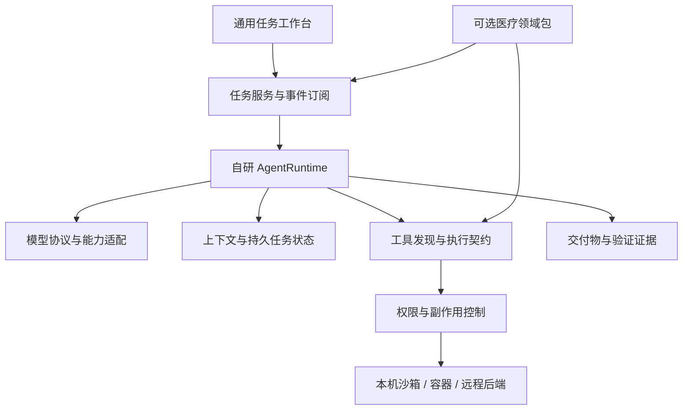

# 自研通用 Agent 底座：实测、差距与改进路线

日期：2026-09-20。审阅基线：`2cb3182` / 0.9.7。本文按产品负责人最新要求修订方向，优先于此前医疗定位分析中的底座选型建议。

文档状态：第 1—8 节是历史证据与路线说明；第 9—19 节是当前执行规格。历史“已修复”仅指当时本地工作区验证，不代表已提交或已同步至其他机器。这是一份分阶段改造与验收总纲，不是完成证明。实施前必须核对实际代码版本。

阅读顺序：先读第 15—18 节理解目标与总指令，再读第 9—14、19 节落实执行与验收，最后核对第 1—8 节历史证据。当前委托范围是 W0—W9；W10 是下一阶段路线，不因出现在全文中而自动要求本轮完成医疗新功能。既有医疗功能兼容及已确认的数据完整性缺陷属于本轮责任。

## 1. 已确定的方向

**底座坚持自研。先达到成熟通用 Agent 的核心能力和使用体验，再进行医疗化深化。** 开源项目作为机制、实现和评测参考，吸纳成熟设计，由本项目掌握执行循环、状态、工具契约、上下文和产品交互。当前不采用外部 harness 替换路线。

“吸纳所有开源基座的核心能力”应落为持续维护的能力地图：每项能力有参考实现、适用条件、本项目差距和实测证据。不能承诺穷尽所有开源项目，也不能将功能并集直接塞进默认工作区。

对“目前还远没有达到通用 Agent 水平”的判断：**当前代码和实测足以支持“尚未达到可稳定交付的通用产品基线”。但尚未完成同模型、同任务的真实对照测试，不能量化落后多少，或把所有差距归因于模型智能。**

## 2. 本次确实运行了什么

上一次停在默认 Node 18 和权限问题处是不充分的。这次找到本机 Node 24.19.0，成功按 package-lock 安装 716 个依赖，运行 Lint、生产构建、全量测试文件及真实 Edge 浏览器场景。

测试未接触真实患者资料，使用内存库或测试临时目录。用户已授权使用桌面端保存的模型，但本机标准配置位置未找到该模型数据库或 model.env；已询问实际安装机器/位置。未改用其他应用的凭据。真实模型评测入口已运行并明确报告无配置，未发起模型请求。

执行证据保存在仓库 `output/`（被 Git 忽略）：

- `audit-lint-20260920.log`：初始完整 Lint 通过。
- `audit-build-runner.log`：Vite runner 配置加载方式生产构建通过，约 49.92 秒。默认构建配置加载阶段长时间无进展，本次停止后改用 runner，不将其写成默认 npm run build 已通过。
- `audit-suite-final/report.json` 与逐文件 TAP：最终有外部截止时间的完整测试文件审计；包含通过、失败、跳过和超时。
- `audit-browser-fixed.tap`：两项路径修复后的 22 个既有 UI 场景；17 通过、5 失败，无跳过。该文件附带的第 23 项通用首页初始断言过弱，虽报通过，已另行加强断言验证。
- `audit-generic-ui.tap`、`audit-generic-ui.png`：通用平台首页的独立失败证据。
- `audit-runtime-probes.json`：合法本地文件 URL 被拒、无工具副作用仍正常结束的局部合成探针。
- `audit-tool-surface.json`：同权限下通用与融合项目工具面测量。
- `audit-real-model/report.json`：真实模型评测 blocked，原因是未找到模型配置。

为避免无限挂起，最终审计按测试文件独立进程运行，单个测试 90 秒、文件 120 秒上限。它不是一次未经修改参数的 npm test。初轮使用 Node --test-force-exit 时出现 Windows libuv 关闭断言崩溃，已取消这个选项重新验收；初轮崩溃不能当成业务功能错误。

### 最终测试汇总

| 项目 | 本次结果 |
| --- | --- |
| 全量文件 | 65 个均已尝试；63 个正常结束，2 个进程超过 120 秒 |
| 正常结束文件的 TAP 汇总 | 278 通过、22 失败、66 跳过、0 取消；不包含超时文件的部分结果 |
| 超时文件 | medical-workspace-fusion、model-switching；日志各自显示 4/3 项断言通过后进程未退出，需检查资源清理，不能算完整通过 |
| 新增路径回归 | 2/2 通过；更新后的 web-search 测试 7/7 通过 |
| 真实 Edge UI | 22 个既有场景中 17 通过、5 失败；独立通用首页另外 1 项失败 |
| Lint | 初始全量和改动文件检查均通过 |
| 生产构建 | Vite --configLoader runner 通过；默认加载方式未完成 |
| 真实模型 | 未运行成功，无已配置模型；不得用合成模型替代该结论 |

22 个失败需要分类处置，不能都算作“Agent 不聪明”：

- **已定位产品实现问题**：写作用域路径比较；离线插件安装在 Windows 重命名目标处 EPERM（重跑复现，需进一步区分现存目录替换语义和占用问题）。
- **平台假设与测试配置**：写死 `/tmp`、Unix shell、POSIX 文件权限；符号链接创建未获系统权限；Mac 微信桥测试在 Windows 执行；真实模型桌面用例的 canRun 判断没有可靠验证密钥和可执行文件。
- **清理/生命周期**：若干临时库目录移除 EPERM，以及上述两个进程无法退出；需要核实句柄关闭和测试 teardown 顺序。
- **待进一步定位**：远程协调器/worker 场景返回 failed，恢复崩溃场景与平台场景的具体异常，不能据此笼统认定全部恢复或远程能力不存在。

5 个 UI 失败均停在“通过 API 播种患者后立即点击左栏患者”的步骤。源码剧本未在播种后主动刷新，前端也未同步这些外部变更；因此目前证明的是测试种子/页面刷新契约与外部更新同步的缺口，不能宣称这 5 项后续业务本身均已坏掉。实际通过 UI 建档、整理、验收和退回修订的场景已通过。

原始报告链接是本机证据，output 不随 Git 默认提交；如需共享，应同时导出所需报告。

## 3. 已确认的产品问题

### 3.1 Windows 主应用可以构建，却无法加载自身静态资源——已修复

真实 Edge 加载生产产物，JS 与 CSS 请求返回 403，界面空白。`server/agent.mjs` 将系统路径和固定 `/` 拼接来检查目录前缀，Windows 路径使用反斜杠，合法资源也被拒。

本次改用平台 `sep`。新增回归验证首页引用的 JS/CSS 返回 200 且 MIME 正确。修复后浏览器能够进入实际界面，完成材料导入与复核等场景。

**意义**：打包、构建和后端测试通过，不等于客户端实际可用。发布门槛必须包含真实目标平台启动。

### 3.2 Windows 合法工作区 HTML 被浏览器工具拒绝——已修复

`server/core/browser-tools.mjs` 用 URL.pathname 解码后 resolve，不能正确处理 Windows file URL 的盘符。对工作区内实际合法路径的函数调用返回 BROWSER_ORIGIN。

本次改用 fileURLToPath，并验证空格、中文、井号与相邻目录边界。既有 web-search 测试写死 Unix file URL，也调整为使用主机真实路径构造，保留越界拒绝断言。

**意义**：Agent 即使会生成网页，也可能无法通过自己的工具检查结果；用户感受到的是“会说会写，但做不完”。

### 3.3 独立通用服务没有完整的通用前端——未修复

启动 createWorkspaceServer 并加载生产页面：仍显示医疗首页、患者导航、临床场景，顶部出现“接口不存在 / 刷新连接”。主页面 refreshList 直接调用 `/api/sessions`，而通用平台使用工作区接口。

`server/platform.mjs` 注释期待前端降级为空列表，实际前端至少有关键请求进入全局错误态。不能用“没有 JavaScript 异常”认定页面可用：本次初始冒烟断言也遗漏了此问题，随后增加“不得显示接口不存在”的断言，复现失败。

**优先级 P0**：建立领域无关的 App Shell 和任务入口，按 bootstrap capabilities 渲染。医疗模块未启用时，不请求医疗接口、不显示医疗默认任务。通用工作区应从进入、交办到产物预览形成独立闭环。

### 3.4 文件写入权限也存在跨平台路径问题——待修复

`assertWriteScope` 使用 path.relative 生成 canonical，再和 `scope + '/'` 比较。Windows 上合法子路径可能含反斜杠。现有 write-scope 测试中，授权范围内提案和子代理写入均出现 WRITE_SCOPE 错误。

**优先级 P0**：统一规范化路径与比较函数，保留真实路径和符号链接检查；验证边界拒绝、相邻目录、大小写及授权变更。不能通过扩大权限或禁用作用域检查来掩盖问题。

### 3.5 执行环境前置直接限制“能干活”——环境事实与设计问题需分开

ProcessRunner 明确只通过 Docker Linux 容器运行，不回退宿主 Shell。本机安装了 Docker CLI，但 daemon 未运行；需要的镜像也未完成验证。这意味着当前机器的真实终端、完整办公产物与部分团队验证没有可用执行后端。

这是本机环境条件，不等于容器方案错误。但让用户自己理解 Docker、镜像、挂载和审批才能开始普通任务，会明显增加使用门槛。

**改进**：自研 ExecutionBackend 接口，由应用提供就绪探测、自动定位、安装/启动指引和必要依赖准备；分别评估 Windows 原生受控进程、容器、远程执行。新增后端必须有实际 OS 隔离与权限测试，不能静默退化成无限权限宿主 Shell。只向模型暴露当前真实可用能力。

### 3.6 普通项目被默认医疗化——待调整

createMedicalWorkspaceDomain 将医疗 discipline 加入所有项目；测试甚至明确要求普通项目始终带医疗工具。在同一基础权限下，本次测得：

| 模式 | 工具数量 | 工具定义 JSON 字符数 |
| --- | ---: | ---: |
| 独立通用工作区 | 23 | 6,941 |
| 医疗应用中的项目工作区 | 48 | 16,633 |

这些数字不代表 token 数，也不能单独证明效果下降。但普通编码/办公任务默认被注入患者建档、医学知识库和医疗回答纪律，与“先通用、领域按需叠加”的边界不一致。

**优先级 P1**：领域包显式启用或经可解释的场景路由启用；通用任务不应带医疗系统指令。工具按能力可用性与任务需要分层发现；是否比全量工具更好，通过同模型 A/B 任务评测决定。

## 4. 底座为什么可能显得不够聪明

### 4.1 模型、工具、环境、状态和 UI 共同决定完成质量

应沿着一次失败的真实轨迹定位：模型有没有理解任务 → 看到了哪些可用工具 → 参数是否正确 → 工具是否真的执行 → 返回是否足够可用 → 是否知道还没完成 → 是否能继续 → 界面有没有呈现结果。

目前已有流式工具循环、参数校验、取消、压缩、恢复、子代理和运行轨迹，不能笼统判断“没有 Agent 内核”。主要缺口是这些机制的默认组合、跨平台运行和最终体验。

### 4.2 完成判断仍过度依赖模型结束回答

AgentRuntime 在无 tool_calls 且 beforeComplete 放行时返回成功。当前 beforeComplete 主要检查团队和异步工具是否仍运行，没有通用的交付物完成契约。

合成探针中，用户要求实际创建文件，脚本模型直接声称已完成，工具调用数为零，循环仍正常结束。这只是边界测试，不是对真实模型幻觉率的测量；普通问答本来就允许零工具完成，不能简单强制每轮调用工具。

**建议**：为执行类任务维护可更新的目标与完成条件，交付时关联事实证据：文件存在且可读、测试退出码、产物预览、外部操作回执。运行状态与完成结果分开：waiting_approval、blocked、failed 属于运行状态，answered、delivered 属于 completed 的结果分类，具体契约见第 12 节。证据不足时继续验证或明确未完成，不能统一标记 completed。

### 4.3 上下文管理存在，但应针对真实模型校准

当前按序列化字符数触发压缩，摘要通过多轮模型合并，原文归档可回查，方向正确。需要进一步测量：中文/代码/图片的 token 预算、工具 schema 开销、长工具结果、模型输出预留、重复压缩损失和响应延迟。

优先保留当前目标、已授权范围、关键决策、已完成副作用、文件版本和未完成事项；避免把工作状态完全托付给一段自由文本摘要。失败时应有可恢复状态，不让用户重新叙述全部历史。

### 4.4 能力发现与错误恢复需要统一

当前工具列表主要按权限过滤，功能分散在服务和扩展模块中。建议将“已授权”“环境已就绪”“当前可执行”分开，形成统一 capability snapshot。失败返回结构化原因与可执行补救动作，防止模型对不可用工具反复尝试。

错误至少区分临时网络、参数不匹配、缺依赖、权限不足、版本冲突、结果未知。只对可安全重试的动作自动重试；未知副作用先对账。工具重复失败应触发替代策略，而不是仅不断增加轮数。

### 4.5 测试数量不能代表真实能力

现有 evaluate-agent 六类任务和 evaluate-generic 二十类任务是可继续建设的基础，但部分提示明确要求调用哪些工具、写什么文件、使用何种编排。这证明模型能遵循具体操作指令，并不足以证明面对自然需求能自主选择正确流程。

应保留“显式工具协议任务”，另建“自然需求任务”，不在提示中告诉模型工具名和步骤。测试输入和验收器分离；比较实际结果，不比较输出话术。

## 5. 吸纳开源能力的具体方式

以下是代表性参考，不是本次对所有项目完成了源码逐行审计，也不表示这些框架在所有任务上优于本项目。官方资料检索日期为 2026-09-20。

| 参考项目 | 值得研究的机制 | 本项目的吸收落点 |
| --- | --- | --- |
| Codex 开源 harness | 执行状态、工具事件、权限与应用边界 | 自研 Run/Event/Approval 协议，重连、追加要求和副作用一致性；不替换内核 |
| OpenCode | 主代理/子代理、按工具权限配置、计划与执行场景 | 简洁的默认执行体验；不同任务角色的能力边界和模型配置 |
| Deep Agents / LangGraph | middleware、持久状态、检查点、按后端能力裁剪工具 | 自研 Context/Tool/Policy middleware 与可恢复状态；不必复制整个图引擎 |
| OpenHands | Agent SDK、工具和执行工作区组合 | 完整开发任务的执行环境契约与端到端评测 |
| Hermes | 技能、长期记忆、历史经验的复用 | 先验证可检索、可修改、可删除的记忆；经验沉淀要有质量与作用域控制 |
| Pi | 分层模型接口、Agent loop、客户端组件 | 保持内核接口小而清晰，扩展与 UI 不侵入状态循环 |

来源：[Codex](https://developers.openai.com/blog/codex-as-a-platform)、[OpenCode Agents](https://opencode.ai/docs/agents/)、[OpenCode Permissions](https://opencode.ai/docs/permissions/)、[Deep Agents 架构](https://github.com/langchain-ai/deepagents/blob/main/libs/ARCHITECTURE.md)、[OpenHands SDK](https://docs.openhands.dev/sdk)、[Hermes 仓库](https://github.com/NousResearch/hermes-agent)、[Pi 仓库](https://github.com/earendil-works/pi)。

每项吸收必须回答：解决了哪个已观察到的失败？是否提升同任务结果？引入了什么运行成本？能否单独测试与撤回？涉及代码复用时记录来源、版本和许可；自研不等于重复实现已有通用依赖。

## 6. 自研架构的建议边界

通用内核负责：目标推进、上下文、执行、工具、取消恢复、权限、事件和证据。通用 UI 负责：一句话交办、材料引用、持续进展、等待用户、成果预览、停止与继续；仅对确实可逆的操作提供明确的撤回功能，不承诺通用撤销。领域包负责：患者对象、医疗来源、专业规则和复核要求。

UI 和领域包都不应各自维护一套运行状态机。医疗允许加强权限和复核，但不改变通用工具的基本执行语义。

## 7. 当前优先级：先把哪些事情做好

| 顺序 | 交付 | 验收 |
| --- | --- | --- |
| P0-1 | 可独立使用的通用首页与任务页面 | 不加载医疗即可创建任务、执行、预览成果、继续历史；无缺失 API 错误 |
| P0-2 | Windows/Mac 路径、文件权限与运行环境 | 合法操作可完成，越界操作被拒；新机器有明确的一次性配置路径 |
| P0-3 | 模型配置自检与真实工具调用验证 | 验证工具 schema、长输出、流式、思考参数与重试；不能只以回复 OK 判断兼容 |
| P1-1 | 读→执行→修正→验证→交付闭环 | 编码、表格、网页、研究等普通需求无需用户指定工具名也能完成 |
| P1-2 | 可持续协作 | 执行中追加要求、停止、重启恢复、审批后续跑，不丢原目标、不重复副作用 |
| P1-3 | 上下文与工具面优化 | 有长任务与失败样本证明改进，测时延、费用、成功率，而非仅扩大上下文常数 |
| P2 | 技能、记忆、团队、MCP 和后台任务质量 | 完整安装到使用、恢复、卸载闭环；多代理只在有收益时使用 |
| 后续 | 医疗包回接与深化 | 同一批通用基线不回归，新增医疗复核与患者管理能力独立验收 |

已有医疗功能保留；实际数据一致性与外发缺陷不能因优先级调整而忽视。但新增医疗场景不再替代通用底座质量建设。

## 8. 对标任务与“更好用”的定义

建议首批 30 个非医疗任务，至少覆盖：代码修复与运行验证、CSV 分析、PDF/Word/Excel 处理、网页生成与自测、联网研究与引用、多文件整理、跨轮修改、MCP 操作、审批接续、取消与恢复。

30 项均有自然需求版本，其中关键任务另设故障注入版本；固定合成输入，验收器独立于提示。先使用同一模型、相近预算对比自研与参考工具，排除模型差异；再比较各产品推荐配置下的真实体验。无法使用同模型时明确披露，不能归因于 harness。

记录：首次完整成功率、需要用户救场次数、无效工具调用、结果返工、首个有效进展耗时、总完成时间、token、产物是否真实存在、恢复成功率。对简单问答不强求工具；对执行任务不能以回答看起来正确替代交付。

本轮发布门槛按第 13 节执行：固定任务集至少 90% 独立完成；安全与副作用关键用例全部通过；已有授权范围内无需重复确认；新增指令不丢失；取消与恢复结果准确。实施者不得为通过验收自行降低门槛。只有连续几个版本在同任务成功率或用户操作成本上稳定优于参考工具，才宣称“更好用”。

研发每一轮应围绕最高频失败轨迹改进：记录失败 → 归类到模型/上下文/工具/环境/UI → 定向改动 → 同任务回归。先建立可靠的个人使用闭环，再扩充任务覆盖面。

## 9. 能达到什么程度，以及不能承诺什么

| 层级 | 可验收结果 | 不代表什么 |
| --- | --- | --- |
| L1：可独立运行 | 通用首页、模型配置、实际执行、成果查看和历史任务贯通，Windows/Mac 各有启动验收 | 不代表复杂任务可靠，也不代表模型变聪明 |
| L2：可靠执行 | 交付有证据；工具错误可恢复；取消、审批、重启行为一致；既有数据可迁移 | 不代表所有外部服务或任意长任务都可靠 |
| L3：有竞争力的个人工作台 | 固定通用任务集达到门槛；同条件对照下成功率与操作成本有证据；自然指令即可交办 | 不代表全面超过 Codex、WorkBuddy 或全部开源框架 |
| L4：可扩展的医疗工作台 | 通用运行机制不分叉，医疗能力按需启用，患者数据一致性、复核和审计通过专项验收 | 不代表具备临床有效性或可直接无人监督诊疗 |

本路线直接目标是 L3，并为 L4 留出并验证接入边界。当前证据显示 L1 尚有阻塞。L1/L2 主要是可控工程目标；L3 取决于模型、工具、环境和真实任务分布，必须实测后判断。不得用“实现了所有模块”代替达到 L3。

“彻底优化”的本轮边界：覆盖任务生命周期、模型适配、上下文、工具权限、执行环境、产物、UI、扩展和发布验证。任意任务全自动成功、无限上下文、所有平台全兼容、不加区分吸纳所有开源功能，都不属于可交付承诺。不在没有基线与试点结果时承诺固定工期或倍数提升。

## 10. 交接规则与设计约束

### 10.1 开始实施前的必做清单

1. 记录工作目录、操作系统、HEAD、未提交差异、Node 版本、运行方式和可用执行后端；确认是 Windows 本地仓库还是 ZCode 中的同名 SSH Mac 仓库。
2. 阅读适用仓库规则及本文；核对第 3 节问题是否仍存在，按“已复现／已修复／版本不符／环境阻塞”分类。不要重复修复已经解决的问题。
3. 保留评估期间已有代码与测试改动，禁止 reset/覆盖他人工作。模型配置只通过项目自己的配置机制使用，不复制其他应用密钥、不打印秘密。
4. 每包先完成自测并记录差异与证据，再进入依赖它的包；不要求逐包等待人工批准。独立复核用于阶段验收，未安排复核时记为待独立验收，并继续不依赖该结论的已授权工作。文档不是自动提交、推送或部署授权。
5. output/ 不随 Git 共享；交接时将所需脱敏报告和复现说明纳入 docs/ 下独立证据目录，或明确提供其他可访问位置。缺失原始报告时重新复现，不捏造已有证据。

### 10.2 必须守住的架构约束

- 保留自研运行内核；允许复用通用依赖与研究开源机制，不把核心循环外包成另一框架的不可控包装层。
- 一套任务事实来源和事件语义；UI、医疗桥接和后台任务不能分别判断同一次运行是否完成。
- 已授权、环境就绪、当前可执行是不同状态；UI 和模型基于同一份能力事实。
- 模型发出调用不等于执行成功；执行成功不等于任务交付；网络断开不等于外部操作失败。
- 医疗模块可以增强限制，不能削弱通用授权边界。通用模式不要求患者对象，也不默认注入医疗规则。
- 复用现有模块优先。任何拆分或新接口先列出调用方、持久化影响和兼容策略，避免重写一个平行系统。

## 11. 分包执行清单与依赖

下表是完整范围。文件是调查入口，不是限制修改范围或已确定的实现方案。每包需要在实施说明中给出最终接口、变更清单、验证结果及未完成项。

| 包 | 依赖 | 调查入口与工作内容 | 完成判据 |
| --- | --- | --- | --- |
| W0 基线与证据 | 无 | 第 2 节测试、package scripts、现有评测脚本；整理环境与失败分类 | 他人在文档指定环境能够复现关键失败；blocked/skip 不算通过 |
| W1 路径与生命周期 | W0 | write-scope、WorkspaceService、agent-team、失败测试 teardown；修复跨平台边界和句柄退出 | 范围内成功、越界拒绝；支持环境内相关测试正常退出；仅定位原因仍属未完成，不靠 force-exit 掩盖泄漏 |
| W2 通用 App Shell | W0 | src/main.jsx、src/workspaces.jsx、server/platform.mjs、domains/medical.mjs | 独立通用服务完成创建→执行→产物→继续；无医疗 API 依赖；医疗入口不回归 |
| W3 模型与环境就绪 | W0 | server/provider.mjs、模型设置、执行后端、verify-model 与 runtime-dependencies | 保存配置可被正确定位；真实流式工具调用通过；依赖缺失有准确原因与可操作入口 |
| W4 状态与事件统一 | W1、W2 | core/agent-runtime.mjs、session-bridge.mjs、runtime.mjs、src/agent-runtime.js | 状态转移与事件恢复测试通过；重复事件不重复执行；旧任务仍可打开 |
| W5 结果验证与恢复 | W3、W4 | beforeComplete、工具执行结果、产物视图、审批与重试 | 执行任务有可验证交付依据；结果未知先核对；取消及恢复不重复副作用 |
| W6 上下文与工具发现 | W3、W4 | 压缩、模型预算、工具注册、domains/medical.mjs | 长任务保留目标/授权/副作用；普通项目无医疗污染；同任务评测无明显退化 |
| W7 交互闭环 | W2、W4、W5 | composer、activity、message、artifacts、任务页面 | 一句话交办、追加要求、审批、停止、继续与成果查看一致；等待原因清楚 |
| W8 扩展质量 | W4、W5、W6 | skills、MCP、extensions、agent-team、scheduler 及记忆实现 | 必测 MCP 与当前提供的扩展能力；安装到卸载、失败恢复、权限撤销可验证；后台状态可见；团队确有收益才默认启用 |
| W9 通用发布门槛 | W1—W7、W8 必测范围 | evaluate-generic、evaluate-agent、桌面构建与真实模型测试 | 第 13 节门槛达标；发布包在 Windows/Mac 真实启动；交付独立验收报告 |
| W10 医疗接入 | W9 | domains/medical、患者、随访、复核与医疗 UI | 通用基准不回归；医疗专项通过；不再维护第二套内核运行语义 |

推荐首包为 W0，第一项代码修复为 W1 的写入边界，再推进 W2/W3。上文 P0 表示风险优先级，不要求机械按表格行号开发。医疗数据覆盖、消息遗漏、外发边界等现有缺陷应另开修复包，与通用建设同步处理，不能等 W10。

依赖表示实施前提，不禁止先做接口设计或模拟验证。W2 的前端开发可先使用模拟服务，但其真实执行验收还依赖 W3；模拟通过不等于 W2 完整完成。W0 完成指基线已记录且失败已分类，不要求基线全部通过；后续包不能以此豁免自身验收。

W8 范围在 W0 冻结：MCP 基准能力和当前对用户提供的扩展能力为必测；尚未提供的高级记忆或团队增强可列为后续项。不得在看到失败后移除基准、隐藏核心能力或缩减范围以取得 L3。未成熟高级入口可以降级为实验功能，但必须披露且不能记为该能力已完成。

## 12. 实施前必须明确的核心契约

以下是语义要求，字段命名可适配已有实现。实施 Agent 应先提交一页契约说明，列出旧字段到新字段的映射，再修改调用方，不能只新增类型而不接通实际运行路径。

| 契约 | 必须表达的内容 | 必测边界 |
| --- | --- | --- |
| CapabilitySnapshot | 能力标识、授权、就绪状态、不可用原因、修复入口、版本 | 运行中授权撤回、依赖失效、模型不支持工具 |
| Run/Task | taskId/runId、目标版本、当前状态、恢复点、等待原因 | 新指令追加、旧运行迟到回包、并发停止与完成 |
| Event | runId、事件序号、事件类型、时间、关联调用、可重放内容 | 断线补发、重复与乱序、UI 重载 |
| ToolResult | 调用标识、成功/失败/未知、结构化错误、副作用回执、产物引用 | 超时后实际已成功、重试重复写入、部分成功 |
| Approval | 审批对象与参数摘要、作用域、有效期或版本、决定 | 超出获批范围、风险或有效条件的参数变化使旧批准失效；范围内变化不重复问 |
| DeliveryEvidence | 对应要求、产物引用、验证方式、验证时间/版本、剩余缺口 | 文件不存在、旧文件冒充本次产物、验证后产物被修改 |
| ContextCheckpoint | 目标、授权、关键决策、已完成副作用、待办、可回查历史引用 | 多次压缩、重启恢复、摘要遗漏、模型切换 |

运行状态至少区分 queued、running、waiting_approval、waiting_input、blocked、cancelled、failed、completed；answered/delivered 可作为完成结果分类，不必混成第二套运行状态。合法转移由单一服务约束，不能由 UI 自行推导。completed 只有在相应任务类型的完成条件满足后产生。

取消意味着停止后续调度并明确已发生/可能发生的副作用，不能宣称撤销已经发出的外部操作。恢复从持久事实继续，不能简单重放整个提示。用户追加要求应产生可追踪的目标更新，不覆盖既有授权或已交付事实。

产物验证按类型选择：文件存在与可读只是最低条件；表格还需核对结果，代码还需相关检查，研究还需来源支持，外部动作还需回执。不得把模型自己的一句“验证通过”当作独立证据。

## 13. 评测设计与阶段门槛

### 13.1 固定 30 项自然需求基准

任务规格已建立于 `evals/general-agent-v1/`：`cases.json` 给出30项任务、合成输入和评估侧答案，`protocol.json` 给出预算与12组故障规格，`README.md` 规定隔离、评分和冻结流程。当前为 **1.0.0-draft，尚未接入运行器、未执行真实模型**。W0/W3 应完成预检、夹具、独立验收器与运行适配，评估方复核后冻结；不得把有数据文件写成评测已经通过。

建议分布：代码与运行 5、文件整理检索 4、表格分析 4、PDF/Word 等文档 4、网页与预览 3、研究与引用 3、跨轮修订与长上下文 3、MCP 与外部模拟服务 2、审批与恢复 2。每项有固定合成材料、用户目标、独立验收器和允许预算；提示不透露工具名与操作步骤。评测清单需要在 W0/W3 阶段落成可执行文件，本表不是已经实现的 30 项测试。

对其中关键任务额外注入：网络断开、工具超时、进程退出、重复回包、权限撤销、文件版本冲突、依赖缺失、上下文压缩、用户取消、执行中改需求。故障版本单独统计，不混入自然任务分母。

### 13.2 统计与判定

- 每个任务至少重复 3 次，30 项共至少 90 次；每次从独立数据与任务状态开始，失败重试不能改写首次结果。
- “独立完成”指交付满足验收器，且不需要用户额外提示工具或修正步骤。正常需求澄清和必要审批单独计数；求救式提示属于人工介入。
- 本轮固定门槛为总体成功率至少 90%、每类别至少 80%；最低 90 次运行须至少成功 81 次，各类别所需成功数向上取整。增加运行次数时按相同比例计算。该门槛不是任意现实任务的成功率保证；调整需明确决策，不能由实施者单方面降低。
- 授权越界、重复副作用、无产物却报告交付、状态恢复等固定关键验收案例全部通过；这是覆盖案例内的保证，不宣称不存在未知缺陷。
- 记录 median/P95 时延、用户操作次数、成本与各任务结果；先拿基线再确定性能预算，不凭空承诺提升倍数。
- 对照包含当前基线、候选版本及至少一个可访问的外部参考产品，在同一组可比任务上记录结果；外部产品同模型不可用时，分别报告产品体验与受控机制测试，不能混为内核能力比较。无法完成外部对照时可报告内部工程门槛通过，但不能宣称完整 L3 或已有竞争力。
- 保留未用于调参的留出任务，发布前验证，防止仅针对固定提示优化。按 `evals/general-agent-v1/README.md`，评估方在实现模型不可访问的位置制作至少10项、覆盖至少5类，每项3次，至少27/30成功且关键副作用检查全通过；单独统计，不与开发集混算。当前仓库中的30项是开发集，不能宣称是隐藏留出集。

### 13.3 阶段放行

L1：W1—W3 的核心启动与真实执行场景通过，Windows/Mac 各有启动证据。缺少其中一个环境时只能报告已验证平台的阶段成果，不能以“阻塞已披露”放行双平台 L1。每个平台至少验证一个受控执行后端，可为相同远程后端；不要求所有后端都实现。

L2：W4—W7 的状态、交付、恢复与交互案例通过，旧数据迁移可回退。

L3：在 L1/L2 已通过的基础上，W9 完成上述真实评测、双平台发布包验证、外部对照及独立复核。30 项至少 90 次的质量评测可在一个明确记录的主评测平台完成，另一平台至少跑通启动、模型调用、文件边界、执行、取消恢复和产物打开的关键冒烟；不得将单平台成功率冒充双平台数据。任何必测真实模型 blocked 的报告都不能放行 L3。要声称“更好用”，还需预先选定成功率或操作成本等指标，多轮对照复测稳定获益，并披露任务范围。

独立复核由非该批实现者的评估人员或评估 Agent 对指定代码版本复跑关键案例并审阅评测证据；实施者换一个提示进行自查不算独立复核。缺少复核资源时交付待验收成果，不虚构放行，也不因此停止其他可独立推进的工作。

## 14. 迁移、回退与每包交付格式

禁止一次性删除旧 MedicalRuntime/SessionBridge 然后再尝试修复所有调用方。先绘制调用与存储依赖，在单一入口引入兼容适配，逐步迁移；旧新路径不得同时执行有副作用的动作。

持久化变更必须有 schema/version 策略、旧任务样本、备份与恢复演练。涉及不可逆字段变更时先保留兼容读取；回退不仅是切回代码，还要说明新数据能否被旧版本读取。测试在副本上完成。

每个任务包固定交付：

1. 问题与复现：环境、版本、输入、预期与实际。
2. 设计：接口、状态或数据变化，为什么不采用更小改动。
3. 实现：修改文件、兼容性影响、已有工作保护情况。
4. 证据：测试命令、结果、真实模型/模拟模型标记、UI 证据、失败及跳过原因。
5. 回退：代码与数据恢复方式，剩余风险。
6. 判定：完成／部分完成／blocked；对应验收条目逐一列明。

若某包连续两轮修改没有改善目标失败，停止扩大改动，回到轨迹归因。缺少配置或依赖时推进独立任务，但不能把跳过改成通过。实施 Agent 按包自测并继续满足依赖的工作；评估方按第 13.3 节复跑关键案例，只有证据充分才正式认定阶段通过。

## 15. 产品总目标：最终要交付什么

### 15.1 一句话目标

**将现有项目优化成一个以自研 Agent 内核驱动、普通用户能自然交办并可靠拿到结果的通用桌面工作台；先证明其通用任务能力与简洁体验，再通过同一底座承载医生日常工作和患者管理。**

这是产品质量与架构能力共同升级，不是只修当前失败测试，不是新增一层聊天 UI，也不是把医疗工具简单移除。最终用户不需要理解 Agent 编排、容器、工具参数或上下文压缩，就能完成已支持的任务。

“自研”要求项目掌握任务状态、执行循环、工具契约、上下文、权限、恢复与应用交互的演进权；不要求自研基础模型、浏览器、文档解析器等所有依赖。不得通过整体套用外部 Agent 框架绕过底座建设。

### 15.2 最终用户体验

用户打开应用后，能够选择工作区、提供材料、用自然语言交办任务。Agent 理解目标，按需要检索资料、读写文件、调用工具、执行与检查，持续呈现有意义的进展，最终提供可打开、可检查、可继续修改的成果。

执行过程中，用户能追加要求、纠正方向、补充材料和停止任务。需要用户决策时，应用说明具体问题与影响；已有授权范围内继续工作，不重复索要许可。依赖缺失或操作失败时，说明实际阻塞与下一步，保留已经完成的工作。

重启或断线后，用户能看见真实状态并继续；已发生的操作不会因为重放历史而重复执行。任务结束时，结果、验证情况和未完成内容清晰可见。普通问答可直接回答，真正执行类任务必须交付实际成果。

### 15.3 三个产品边界

1. **通用模式**：服务于文件、研究、办公、网页与开发等任务，不要求患者身份，不注入默认医疗指令。
2. **医疗模式**：在同一个任务工作台上增加患者上下文、随访、临床记录、专业资料和复核能力。医生仍以自然语言交办，专业约束由领域模块落实。
3. **设置与高级能力**：模型、执行环境、MCP、技能和团队的配置采用渐进呈现；简单任务不经过复杂配置向导或人工编排。缺少必要配置时精准引导，不假装能力可用。

## 16. 完整能力目标与边界

下表定义目标覆盖面，不要求所有能力在第一批实现。每一行都应在任务账本中有对应任务、现状和验收证据；已有可靠实现应复用，不重复造轮子。

| 能力 | 最终要求 | 验收重点 |
| --- | --- | --- |
| 目标理解与推进 | 从自然需求提取目标，复杂任务可分步，简单任务直接处理；必要时澄清 | 不依赖用户提供工具名；不以一段计划代替执行 |
| 模型适配 | 配置保存、实际调用、流式和工具协议一致；能力差异可识别 | 至少实际验证当前使用模型；不宣称未经测试的提供方兼容 |
| 工具调用 | 参数校验、结构化结果、错误分类、超时和可控重试 | 对未知副作用核对后再重试；调用与结果关联完整 |
| 执行环境 | 明确的后端接口、就绪诊断、工作目录与产物回收 | 至少一个真实可用后端；其他后端明确支持或不支持，不要求一次实现全部 |
| 文件与工作区 | 跨平台读写、引用、预览、版本冲突和作用域约束 | 合法路径可用、越界拒绝；不覆盖用户并行修改 |
| 网络与浏览器 | 获取公开资料、必要交互、引用与网页检查 | 能核对实际页面与来源；受限时如实报告，不编造检索结果 |
| 办公与开发产物 | 对支持的文件类型形成创建、检查、修改、交付闭环 | 文件可打开且内容正确；复杂版式需渲染检查；代码有适当运行验证 |
| 上下文 | 管理长输出、材料、工具结果与多轮目标 | 压缩后仍保留授权、决策和已完成副作用；历史可回查 |
| 任务持久化 | 历史任务、检查点、恢复与可追踪事件 | 重载与断线后状态一致；不重复执行已确认动作 |
| 用户协作 | 追加要求、澄清、审批、停止、继续 | 新指令不会丢失；停止状态准确；不靠刷新页面才能看到结果 |
| 交付验证 | 按任务类型判断结果，关联产物及证据 | 不存在的文件、过期结果、失败动作不能被宣称完成 |
| 技能与 MCP | 可发现、启用、使用、诊断、更新和移除 | 权限与可用性一致；失败可定位；不把大量工具默认塞给模型 |
| 记忆 | 可选且有作用域、来源、查看、纠正和删除机制 | 不把过时或错误记忆当永久事实；不混用不同患者或工作区内容 |
| 团队与后台任务 | 在收益明确的任务中使用，可追踪、取消和恢复 | 不为展示多代理而增加成本；后台任务不成为不可见副作用 |
| 诊断与发布 | 运行轨迹、错误定位、平台验收和脱敏报告 | 安装产物能真实启动；秘密不进入报告；问题可复现 |
| 医疗接入 | 领域对象、规则和复核与通用执行解耦 | 患者隔离、版本冲突、消息处理和外发边界通过专项测试 |

技能、记忆、团队等高级能力不是 L1 的阻塞条件；若已有能力仍在界面中作为可用功能提供，就必须验证，不能以“后续优化”为由保留虚假可用入口。未达到质量标准的能力应明确标记状态，或暂不进入默认体验。

### 16.1 简洁体验也是硬性验收项

- 默认界面围绕任务、输入与材料、执行进展、成果组织；高级运行细节可展开查看。
- 常用任务从自然语言开始，不要求用户手动选择规划器、执行器、工作流节点。
- 执行状态至少让用户理解：正在做什么、是否等待自己、是否受阻、结果在哪里。
- 错误提示描述用户遇到的问题和可做的下一步，技术细节放在诊断入口。
- 不通过大量按钮、多个任务中心或重复导航暴露内部架构；共用一套任务入口与状态语义。
- 用固定任务记录点击数、重复输入、人工救援与完成时间；截图美观不能替代操作验收。

## 17. 执行方向与决策原则

### 17.1 先解决实际阻塞，再扩大能力

先做可运行与可交付，再做复杂协作与效率优化，最后深化医疗场景。任何新模块都应关联已观察到的失败，或本文件明确要求的用户任务；不能仅因某开源项目存在该模块就照搬。

研究开源项目时维护机制对照表：来源版本、机制解决的问题、适用场景、本项目现状、采纳方案、许可、验证结果。吸收能力和设计思想，不追求功能数量。表中代表项目不是白名单，也不是要求逐个集成的依赖列表。

### 17.2 允许实施 Agent 自主决定什么

在已授权范围内，自主决定内部模块组织、实现细节、适当测试、可逆重构与错误修复；不必每个函数、每个任务包都询问用户。可以根据新证据调整局部顺序，但要记录原因并保留总目标与验收要求。

下列情况需要明确提出决策：目标之间有冲突、需要新增外部费用或权限、需要不可逆数据处理、无法找到必须的模型配置、需要改变自研路线或产品范围。说明已完成内容、阻塞证据和最小所需信息；独立部分继续推进。

### 17.3 避免两个执行偏差

**偏差一：只修几个测试然后宣布优化完成。** W1 是第一项修复，不是最终任务。总体完成要逐条核对 W0—W9、能力矩阵与 L3 证据；W10 是后续医疗深化阶段。

**偏差二：一次大重写所有模块。** 总体授权不等于同时改所有层。以可测试的小批次推进，包内形成完整运行路径，包间保持兼容与可回退；未接入实际入口的代码不能记为功能完成。

## 18. 给实施模型的完整总指令

以下内容用于整体优化委托，替代此前只要求执行首项修复的简短指令，也替代《ZCode实施任务书与验收计划》中首条指令的范围限制。配合本文全文与实际仓库使用；实际用户后续指令优先。

> 你负责实施 open-medical-workbench 的通用 Agent 底座系统性优化。完整阅读本文件，先理解产品目标，再检查代码与环境。目标是保持底座自研，使应用首先成为自然语言可交办、工具真实可执行、结果可验证、过程可协作、故障可恢复、体验简洁的通用桌面工作台，达到本文 L3 的可验证标准，再为医疗领域接入保留并验证边界。不是只修复当前测试，也不是替换成外部 Agent 框架。
>
> 先完成 W0：核对目录、平台、HEAD、未提交修改、运行方式、模型与执行环境。当前历史报告只代表其记录版本；重新确认关键问题。保留现有工作，不覆盖或回滚他人改动。真实模型优先使用项目桌面端已保存配置，缺失时明确阻塞，不使用其他应用凭据或模拟结果冒充。
>
> 建立持久任务账本，将 W0—W9 和能力矩阵拆成可执行子任务，记录依赖、验收条件、状态、证据、当前下一步。W10 为通用阶段通过后的医疗深化；已有医疗数据安全与完整性缺陷需要及时处理。首项代码修复建议从 W1 写入范围开始，再按依赖推进通用入口、环境、状态、验证、上下文和交互。新证据可以调整顺序，但必须解释。
>
> 按小批次实现完整路径，每批检查设计、接口、持久化兼容、回退与验证。达到当前包自测条件后，可继续已授权且依赖满足的后续任务，不因“已完成一个包”自动结束，也不反复请求常规实现许可。保留每包审查材料；实施自测通过与评估方独立验收是不同状态。最终 L3 声明必须有独立复核，不能由你的完成话术替代。
>
> 所有改动遵守单一任务事实来源、统一状态事件、权限与就绪分离、副作用可追踪、医疗按需启用的约束。不能通过禁用权限、削弱验收语义、删除有效失败用例、强制退出进程、伪造产物或隐藏报错获得“通过”。允许修正错误或过时的测试假设，但必须说明原因并保留等价的行为与边界覆盖；超时清理可终止测试进程，但该次仍记为失败或超时。不可逆操作、提交、推送和部署不在本指令的默认授权范围内。
>
> 对简单任务保持直接交互，对复杂任务实现理解→行动→检查→修正→交付。用户不需要指定工具名或了解编排。任务结束必须区分回答、真实交付、等待用户、阻塞和失败。停止与恢复准确，已有授权不重复确认，执行中新要求可追踪。
>
> 建立并运行本文的自然需求基准、故障注入、平台验证和真实模型测试。每个结果标记真实模型或模拟模型；通过、失败、跳过、阻塞分别统计。不要用单元测试总数、工具数量、代码量或漂亮截图证明产品成熟。无法运行的检查不能记为成功，也不能无限拖延：定位原因、完成可推进部分并报告缺口。
>
> 每批交付根因、改动、证据、兼容影响、回退和剩余事项。持续更新账本；上下文切换前留下准确接续信息。最终逐项报告达到的层级、未达标条件与原因，避免“彻底优化完成”等无证据表述。只有工程实现、真实用户路径和目标验收同时满足，才可将相应阶段标记完成。

## 19. 最终交付清单与接续要求

整体交付至少包含：可运行代码、必要配置与环境说明、接口及状态设计、兼容迁移与回退说明、任务账本、脱敏测试证据、真实模型评测、目标平台 UI/安装验证、已知限制与未完成项。产物路径写入任务账本，避免关键信息只存在于聊天记录。

账本状态建议为 pending、in_progress、self_verified、independently_verified、blocked；状态要绑定代码版本与证据。重要代码变更后，旧验证不能无条件沿用。会话中断时保留当前分支/版本、未提交改动、最近验证、运行服务、失败原因与下一项操作，不把“下一轮重新分析”作为交接方案。

实施前还需形成的具体内容包括：现有字段与目标契约映射、30 项基准材料与验收器、模型实测配置、性能预算、迁移脚本。它们是任务的一部分，不是要求用户替实施 Agent 先补齐全部细节。只有必须由用户提供的信息才请求澄清。

完成判定：W0—W9 必测范围按第 11 节冻结并逐项提供证据，L3 门槛按第 13 节经过实际验证和独立复核，剩余限制明确披露；若只达到 L1 或 L2，准确报告已达到层级并继续处理可推进的未完成目标，不把阶段成果包装成整体完成。外部资源或独立验收阻塞时，交付准确的待验收状态，不要求无效循环。医疗新功能深化另按 W10 验收。
